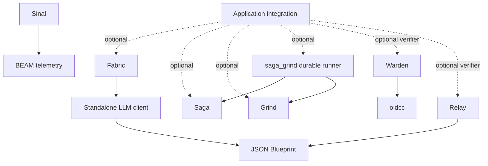

# Initial ecosystem creation plan

## Purpose and decision status

- Build an ecosystem of independently useful Gleam libraries for production Erlang/OTP applications. Libraries compose through typed public contracts and reuse established implementations when that preserves the intended behavior.
- This plan consolidates the rough designs and research into a proposed development direction. Recommendations are explicit; compiler experiments and behavior tests have not yet established their correctness.
- Erlang/OTP is the first production target. Keep pure components portable where practical without making JavaScript support a condition for every release.
- The immediate work is interface exploration in `oversight`. Production implementation follows accepted contracts and evidence from the required feasibility checks.
- The retained [interface playground](playground/interface_lab/README.md) now makes the candidate contracts inspectable. Its [findings](playground/interface_lab/FINDINGS.md) distinguish compiler evidence from unfinished runtime guarantees, including the proposed Saga checkpoint boundary.
- The [public-interface stress exploration](playground/interface_lab/STRESS-TESTS.md) tests broader adoption scenarios. It identifies missing public contracts; the package boundaries are not ready for promotion merely because the current examples compile.
- Initial releases are increments toward the declared package goals. A smaller first release does not redefine a feature-complete target as delivered.

## Recommended library boundaries

| Library or working unit               | Recommended responsibility                                                 | Initial useful slice                                                                         | Growth after the slice                                                                                              |
| ------------------------------------- | -------------------------------------------------------------------------- | -------------------------------------------------------------------------------------------- | ------------------------------------------------------------------------------------------------------------------- |
| JSON Blueprint                        | Typed JSON codecs and their schema descriptions                            | A record/union codec produces encoder, decoder, and schema through one controlled definition | Broader schema support, migration guidance, optional generation, and a distinct runtime-schema layer                |
| Sinal                                 | A typed façade over BEAM telemetry                                         | Typed events and spans with synchronous dispatch and explicit handler-failure behavior       | Bridges and exporters through existing telemetry infrastructure                                                     |
| Warden                                | Typed OIDC relying-party and OAuth client operations                       | A narrow, verified authorization-code flow over an established backend                       | Additional independently tested client operations and provider compatibility                                        |
| Relay                                 | MCP protocol behavior, typed client/server APIs, and transports            | A 2026-07-28 Streamable HTTP server slice with discovery and typed tools                     | Stdio, 2025-11-25 compatibility, client operations, and additional capabilities under explicit conformance coverage |
| Standalone LLM client; name undecided | One model interaction, streaming lifecycle, and provider adaptation        | A small common contract exercised by contrasting provider protocols                          | Additional providers and optional provider-specific integrations                                                    |
| Fabric                                | Bounded agent execution, typed tools, and action policy                    | A scripted-model agent loop with explicit outcomes                                           | Provider integrations, durable suspension, and workflow composition                                                 |
| Saga                                  | Typed workflow definitions and compensation semantics, with a local runner | A shared-dependency workflow with heterogeneous results and undo                             | Nested workflows, a restricted durable definition, and a Grind-backed runner through optional integration           |
| Grind                                 | Durable jobs and queue scheduling                                          | A Postgres queue with typed worker registration and explicit delivery semantics              | Typed Saga-authored workflows plus the declared Oban compatibility scope and advanced capabilities                  |

- These are responsibility boundaries rather than eight simultaneous implementation projects. Confirm public packaging after the consumer examples demonstrate independent use.
- Keep Relay's core, client, server, transports, and test support as deliberate modules initially. Split distribution units when target support or optional runtime dependencies justify them; do not publish eight packages merely because the draft lists eight modules.
- Give the LLM client its own logical boundary from the beginning. Provider-neutral messages and model contracts belong below Fabric, even if early experiments keep all source in one workspace.
- Keep runtime-authored graph schemas separate from statically typed Saga plans. An arbitrary runtime schema cannot create a new native Gleam type after compilation.
- Reuse Saga authoring for typed Grind workflows through a restricted durable definition and optional `saga_grind` runner. A Saga may also be an opaque node in Fabric or an external graph; the [composition proposal](research/composition-contracts.md) refines the earlier separation of runtimes without merging their recovery contracts.

## Build, reuse, and wrap recommendations

| Area           | Default decision                                                                                                                    | Reason and boundary                                                                                                                                          |
| -------------- | ----------------------------------------------------------------------------------------------------------------------------------- | ------------------------------------------------------------------------------------------------------------------------------------------------------------ |
| JSON Blueprint | Evolve the existing library through a breaking codec API if required                                                                | Existing schema/decoder work is useful; separate encoders and legacy decoder compatibility do not establish the new contract                                 |
| Sinal          | Build a thin typed façade over `:telemetry`                                                                                         | Reuse dispatch and BEAM instrumentation compatibility; do not introduce an actor per event                                                                   |
| Warden         | Wrap `oidcc`; keep protocol and crypto machinery upstream                                                                           | Own typed boundaries and caller responsibilities explicitly; wrapping does not inherit backend certification                                                 |
| Relay          | Build a typed protocol implementation with upstream conformance evidence                                                            | The inspected Gleam alternatives target older, narrower protocol surfaces; keep them as reference material rather than assume current conformance            |
| LLM client     | Build a small Gleam core with separately selectable adapters; first attempt narrow reuse of public `anthropic_gleam` APIs           | Keep transport and loop ownership explicit; use native wire code if the reused adapter fails the common contract; ReqLLM remains an optional broader backend |
| Fabric         | Build the typed agent state machine and tool/policy integration                                                                     | Reuse the one-call client and selected execution adapters; do not recreate provider networking inside the loop                                               |
| Saga           | Build typed authoring and a native local runner, using Reactor as a scoped oracle; share semantics with a restricted durable runner | Prove the representation before requiring one generic interpreter; persistence-ready definitions are not arbitrary local plans                               |
| Grind          | Build a native durable-job engine, using Oban as the primary scoped oracle                                                          | Control worker codecs and persistent state; keep existing Gleam queues as comparators until they satisfy the recovery and compatibility contracts            |

- Sinal's static guarantee applies to code using the same typed event descriptor. Foreign emitters and independently defined descriptors with the same event name remain runtime boundaries and must be decoded explicitly.
- Use OpenTelemetry libraries for tracing/export where suitable. Event dispatch and trace export are different responsibilities; a tracing API is not a substitute for telemetry interoperability.
- Warden owns OIDC relying-party and OAuth client behavior. Relay owns MCP protected-resource metadata, challenges, resource/audience binding, and scope policy through a verifier interface; an optional Warden adapter does not make Warden a mandatory dependency.
- Relay also owns MCP-specific client authorization: protected-resource and authorization-server discovery, resource indicators, issuer-bound credentials, scope accumulation, callback checks, refresh orchestration, and bounded retry. Warden may supply generic primitives through an adapter, but its login API does not own the MCP flow.
- Target MCP 2026-07-28 as current, with 2025-11-25 compatibility added deliberately. The official versioning page identifies the newer revision as ready for use, correcting the rough draft's description of it as a future draft. [MCP versioning](https://modelcontextprotocol.io/docs/2026-07-28/learn/versioning)
- The initial Relay HTTP experiment is a local/scripted protocol implementation, not an authenticated public deployment. Protected deployment requires the verifier and authentication contracts even if the broader OAuth feature set follows later.
- Use `oidcc` 3.9.0 as the researched Warden baseline and recheck advisories at adoption. Earlier draft references need correction because the upstream advisory identifies 3.9.0 as the fix for an unsigned-token validation flaw. [Upstream advisory](https://github.com/erlef/oidcc/security/advisories/GHSA-533g-4vf3-xwrj)
- Do not adopt `bg_jobs` or `gabsurd` as a production foundation in this plan. The inspected versions leave recovery or persisted-state requirements unmet; the [execution research](research/workflow-boundaries.md) records specific findings and the evidence that could reverse this recommendation.
- Evolve JSON Blueprint toward one selected JSON Schema dialect and an explicitly supported vocabulary. Use fallible encoding for constraints not guaranteed by the Gleam value type; total encoding is appropriate only when every constructible value is valid for that codec.
- A shared type parameter does not prove that user-supplied getters and mappings are inverse operations. Keep arbitrary domain validation separate from exact schema/decoder agreement unless the schema expresses the same restriction.
- Start JSON Blueprint's new contract with a Draft 2020-12 subset and pin the validator's version and keyword configuration when building its behavior harness. Define optional versus nullable, unknown-field handling, finite numbers, and union overlap explicitly before adding broader keywords.
- If `encode(x)` succeeds with JSON `j`, require `decode(j) == Ok(x)` and schema acceptance of `j`. Require equivalent schema and decoder acceptance only over the supported schema vocabulary; an unrelated business validator must not silently narrow that claim.
- Sinal's typed metadata decoders read their owned fields while preserving reserved span metadata at the bridge. Reject collisions with reserved fields, and test that additional foreign fields do not break instrumentation interoperability.
- Attempt Anthropic reuse through public request/response and incremental stream-decoding APIs, not its buffered convenience stream or agent-loop ownership. Select native adapter code if reuse requires internal imports or cannot satisfy cancellation, continuation, and error contracts; keep the core API unchanged.
- A ReqLLM FFI adapter is technically feasible because current Gleam accepts Mix dependencies. Keep it optional initially; its Elixir build/runtime dependencies and stream ownership require a clean consumer build/release test plus the same provider contract suite before adoption. [Gleam dependency support](https://gleam.run/documentation/gleam-toml-reference/)

## Dependency direction

- Solid arrows show proposed foundational dependencies; dotted arrows show application-selected composition. Instrumented OTP components also emit through Sinal; serialization-dependent modules may use JSON Blueprint without forcing a schema requirement on in-memory Saga plans.
- Keep optional integrations in examples or separate adapters until independent adoption justifies publishing them. A module that requires Saga or Grind inside the Fabric package would still impose that package dependency on every Fabric user.

## Execution and durability ownership

| Owner      | Responsibility                                                                                                    | Does not imply                                                              |
| ---------- | ----------------------------------------------------------------------------------------------------------------- | --------------------------------------------------------------------------- |
| LLM client | One model call, transport deadlines, stream cleanup, safe pre-output retries                                      | Automatic retry of an already observed result or an application tool effect |
| Saga       | Typed dependency and compensation semantics; local scheduling and retry in local mode                             | Automatic persistence of an arbitrary local plan                            |
| saga_grind | Durable workflow progress, readiness, activity retry, branch selection, and compensation journal                  | Ownership of queue leases or duplication of the local Saga scheduler        |
| Grind      | Durable admission, claims, leases, job attempts, delayed retries, cancellation intent, and abandoned-job recovery | Exactly-once business effects or workflow compensation                      |
| Fabric     | Agent-turn state, transcript, approval identity, continuation version, and atomic review revision checks          | A general-purpose durable graph engine                                      |
| Sinal      | Dispatch of observations                                                                                          | Authority over job, workflow, or agent state                                |

- The first durable Fabric integration requires a Fabric-owned continuation-store interface with compare-and-set revision checks. Grind carries a continuation reference and dispatches start/resume work; Fabric restores versioned state and constructs fresh in-memory work after each durable boundary.
- A resumed operation may build a new Saga plan when it needs dependency execution or compensation. A basic agent loop does not require Saga, and a basic Saga workflow does not require Grind.
- A Fabric continuation may instead retain a durable Saga run reference and wait for its terminal result. The durable runner owns the child's workflow journal; Fabric owns only its parent continuation and revision.
- The durable runner coordinates operation completion and dependent-job admission transactionally or through an outbox. Queue delivery recovery and retry after an observed activity failure remain separate policies and counters; telemetry is observation rather than reliable workflow control.
- Reject stale or duplicate approval commands through revision and command identity checks. These checks do not guarantee that an external tool effect happened exactly once.
- Prevent repeated application of an effect only where a downstream idempotency key, fencing contract, or atomic effect-and-completion transaction provides that guarantee. Otherwise a crash after the effect but before acknowledgement must produce an ambiguous outcome with an explicit reconciliation path.
- Defer an independent general-purpose durable graph engine inside Fabric and historical forks. Explore the Saga/Grind durable runner first; it adds real coordination and journaling work while reusing Saga's declared semantics and Grind's queue execution.

## Composition rules

- Share serialization contracts where consumers need the same meaning. Do not require a general in-process value to have a JSON Schema merely because another package uses JSON.
- Preserve concrete types until an external or heterogeneous registry boundary requires a uniform representation. At a tool registry, capture each typed handler together with its codecs in an opaque invocation value.
- Keep application orchestration outside foundational libraries. JSON Blueprint does not know tools, Sinal does not know jobs, and the LLM client does not run an agent loop.
- Use package-specific error types with explicit adapter mappings. A universal ecosystem error type would make unrelated libraries coordinate every new failure variant.
- Assign one retry owner to each boundary. A transport retry, a job attempt, and workflow compensation are different operations and must not multiply invisibly.
- Cancellation stops owned work and releases resources according to the component's contract. It does not imply that an external side effect was undone.
- Persist stable identifiers, versioned data, and explicit continuation state. Do not treat captured closures, live processes, or arbitrary encoded BEAM terms as a durable workflow format.
- Use runtime validation for runtime-selected models, dynamic schemas, graph publication, and untrusted protocol input. Label these guarantees separately from compiler-enforced type compatibility.

## Consumer examples that determine the interfaces

| Consumer                        | Demonstration                                                                                            | Architectural conclusion it tests                                                  |
| ------------------------------- | -------------------------------------------------------------------------------------------------------- | ---------------------------------------------------------------------------------- |
| Ordinary web application        | Complete a login through Warden without Relay, Fabric, or a job queue                                    | Authentication is independently adoptable                                          |
| Command-line tool server        | Expose a typed search tool through Relay using a shared codec                                            | Protocol tooling does not require an agent runtime                                 |
| One-shot extraction application | Call an LLM and decode a typed result without Fabric                                                     | The model client is independently useful                                           |
| Agent application               | Register search and notification tools with different types; use a scripted model or configured provider | Tool heterogeneity and provider substitution work through public APIs              |
| Business workflow               | Create an order, reserve inventory, charge payment, and compensate earlier effects on failure            | Saga's execution semantics are distinct from persistent job delivery               |
| Durable business workflow       | Use one persistence-ready Saga definition through local and Grind-backed runners                         | Typed authoring can be reused without pretending that arbitrary closures persist   |
| Nested graph                    | Use the checkout Saga as one node and choose explicit compensation behavior on later outer failure       | Workflow reuse does not require flattening or two schedulers owning the same steps |
| Background worker application   | Enqueue typed notification work and recover after worker termination                                     | Grind can be adopted without an agent or graph framework                           |
| Durable review application      | Suspend an agent action for approval, persist its state, and resume with duplicate answers rejected      | The chosen durable integration has one explicit owner for suspension and recovery  |

- Test pairs of libraries before a combined application. A demonstration that requires every package would hide unnecessary dependencies.
- A successful pure function call is insufficient for durable composition. Approval suspension, cancellation, ambiguous side effects, and serialization need explicit outcomes and ownership.

## Interface laboratory

- Keep experiments inside `oversight` with small Gleam projects and path dependencies. Use the configured project compiler and agent-lsp once its MCP registration is loaded.
- Prototype only enough types and signatures to answer a named question. Named unfinished bodies may describe unimplemented runtime operations, but their successful compilation proves only that consumer signatures fit.
- For a claimed static construction guarantee, provide a minimal representation and constructor path without unfinished bodies, panics, unsafe casts, or placeholder FFI. Constructing records and closures is type-level evidence; scheduler, storage, network, and recovery behavior remain outside this first laboratory.
- Maintain compiling consumer examples and separate expected-failure fixtures. Count an expected failure only when the intended type mismatch occurs, not when an unrelated dependency or syntax error occurs.

| Experiment                 | Required result                                                                                                                  | Evidence still needed afterward                                                                                                                          |
| -------------------------- | -------------------------------------------------------------------------------------------------------------------------------- | -------------------------------------------------------------------------------------------------------------------------------------------------------- |
| Shared codec               | Record and union builders require correct getters and constructors; encoders cannot be paired with unrelated typed values        | Encoding, decoding, and schema validation agree on accepted values                                                                                       |
| Heterogeneous tools        | Two unrelated tool signatures coexist after a controlled registration boundary                                                   | Invalid wire input fails before application code; tool identity remains correct                                                                          |
| Provider substitution      | Two protocol families and a scripted third adapter satisfy the common call contract                                              | Streaming, continuation, provider options, and unsupported features behave as declared                                                                   |
| Telemetry interoperability | Typed event constructors and foreign-event decoders define where shape is checked                                                | Handler timing, failure isolation, and interaction with raw telemetry preserve the declared semantics                                                    |
| Telemetry spans            | Owned and reserved metadata are represented without collisions                                                                   | Start/stop/exception names, native-time units, span context, stop metadata, exception representation, and re-raising match the chosen telemetry contract |
| Workflow ownership         | Shared dependencies and heterogeneous undo are expressible without a public dynamic-value map                                    | Each dependency is admitted once absent declared retry; retries, ambiguous effects, and compensation obey their contracts                                |
| Authentication boundary    | Client, resource-server, token, and verified-identity roles cannot be confused at the public boundary                            | Issuer/audience checks, replay protection, and protocol conformance hold                                                                                 |
| Durable suspension         | Completed, failed, awaiting-approval, and ambiguous-effect outcomes remain distinct; the store contract requires compare-and-set | Revision conflicts, restart recovery, duplicate approval commands, and external-effect ambiguity are handled correctly                                   |

- Do not accept a representation because arbitrary signatures containing unfinished bodies compile. A claimed type guarantee needs a constructive representation or a separately identified feasibility check.
- Add composition fixtures for one durable Saga definition used by local and Grind-backed runners, and for a Saga embedded as a graph node with explicit outer-failure policy. Check submission versus final output, local versus durable compensation receipts, and suspension versus failure.
- Accept each interface slice when its constructive example compiles, negative examples fail for the intended reason, dependency direction is verified, and runtime questions have assigned tests and owners. Use the smallest downstream pair that proves composition; foundations do not wait for every later ecosystem consumer.

## Production sequence after interface acceptance

| Work group                        | Delivery                                                                                  | Exit evidence                                                                                                                              |
| --------------------------------- | ----------------------------------------------------------------------------------------- | ------------------------------------------------------------------------------------------------------------------------------------------ |
| Shared foundations                | Codec slice and typed telemetry slice                                                     | Codec laws, independent schema validation, telemetry compatibility, and downstream consumer examples                                       |
| Independent integration libraries | Warden flow and Relay tool protocol slice                                                 | Wrapper-specific tests, pinned protocol coverage, scripted peers, and interoperability checks                                              |
| Model and agent composition       | One-call client followed by the bounded Fabric agent loop                                 | Provider fixtures, stream lifecycle tests, heterogeneous tools, explicit approvals, and bounded execution                                  |
| Jobs and compensated workflows    | Grind queue slice and Saga execution slice                                                | Differential behavior, database/process fault scenarios, cancellation, compensation, and resource bounds                                   |
| Durable composition               | Saga/Grind durable runner plus Fabric-owned parent continuations and child run references | Transactional admission, compensation journals, restart/replay, approval dedupe, external-effect reconciliation, and version compatibility |
| Broader capability coverage       | Additional protocol features, providers, queue features, and advanced workflow behavior   | Incremental coverage against each package's declared full target                                                                           |

- Work groups express dependencies, not calendar promises. Warden can progress independently; durable Fabric execution waits for its persistence contract rather than forcing all other work to wait.
- Keep production work to a small number of independently reviewable increments. Dispatch agents on bounded deliverables whose contracts are already settled; the coordinator reconciles cross-package changes before accepting them.
- Treat a provider adapter or protocol revision as an independently testable compatibility unit. Adding one must not require unrelated consumers to adopt its options or dependencies.

## Required refinement of the rough designs

| Draft                   | Change before implementation                                                                                                                                                  |
| ----------------------- | ----------------------------------------------------------------------------------------------------------------------------------------------------------------------------- |
| JSON Blueprint proposal | Specify the bidirectional codec, fallible encoding, supported schema dialect, domain-validation boundary, and 1.x migration behavior                                          |
| Sinal                   | Replace actor-per-event dispatch with a telemetry façade; state the descriptor's limited static guarantee and span metadata contract                                          |
| Warden                  | Pin a patched backend, distinguish wrapper responsibilities from backend guarantees, and verify bounded HTTP behavior                                                         |
| Relay                   | Treat 2026-07-28 as current; separate revision-specific protocol behavior; define exact server/client conformance claims and independent auth roles                           |
| Fabric                  | Move the model contract below the agent; replace homogeneous tool lists with typed registration; separate agent state from provider networking and general workflow execution |
| Saga                    | Separate statically typed plans from runtime-authored schema graphs; specify shared-node identity, cancellation, retry, compensation, and undo-error behavior                 |
| Grind                   | Define the public Oban parity target and advanced feature contracts separately; specify at-least-once effects, claims, leases, codec versions, and schema migrations          |

- Preserve full intended capabilities in each draft's growth path. Mark an intentionally deferred capability rather than deleting it merely because it is absent from an initial slice.
- Refine Saga and Grind's workflow sections together: Saga owns shared authoring and compensation semantics, while its optional Grind-backed runner owns durable progress. Preserve raw Grind job workflows, and state that an arbitrary local Saga plan cannot be submitted durably without satisfying the durable-definition contract.
- Refine Fabric's graph composition around typed nested nodes. A later outer failure leaves a successful child Saga's effects intact unless the host explicitly registered a compensation receipt; suspension must not be converted to an ordinary failure.
- Decide action-policy defaults in Fabric's typed construction API. Approval-required and denied outcomes must be explicit; omission of policy configuration must not silently establish an allow-all production policy.
- A configurable allow-all policy may be used explicitly in oracle comparisons. It must not be described as evidence that approval and denial behavior works.

## Bounded checks that can change the recommendations

| Default recommendation                                           | Check                                                                                                                    | Result that changes the plan                                                                                                                                                         |
| ---------------------------------------------------------------- | ------------------------------------------------------------------------------------------------------------------------ | ------------------------------------------------------------------------------------------------------------------------------------------------------------------------------------ |
| Update JSON Blueprint with typed combinators                     | Construct record and union codecs; test their laws against a pinned independent validator                                | An ergonomic builder cannot preserve the supported contract; revise its vocabulary or use generation before expanding the API                                                        |
| Sinal wraps telemetry                                            | Compare typed and raw callbacks, decoding failures, span metadata, and caller-process behavior                           | The façade cannot preserve the required upstream semantics; revise the bridge rather than claiming equivalence                                                                       |
| Native Saga and Grind with upstream oracles                      | Prove typed node representation and run the declared scheduler/queue fault scenarios                                     | A representation or recovery contract fails while an upstream adapter satisfies the same tests; revisit the relevant backend only                                                    |
| Provider-independent one-call client with selectable adapters    | Run the same consumer through contrasting protocols and a scripted unsupported-capability adapter; test public-API reuse | Ordinary control flow repeatedly requires provider knowledge; reduce the common contract; replace a failing reused backend with native wire code or a proven optional ReqLLM adapter |
| Warden delegates protocol and JOSE behavior                      | Exercise malicious discovery/response cases against the exact HTTP-adapter seam                                          | Required limits cannot be enforced; provide a bounded custom adapter before release                                                                                                  |
| Saga-authored durable workflows with Fabric parent continuations | Run one typed workflow locally and through Grind, then embed it as a node with approval and outer-failure cases          | Shared authoring cannot preserve the declared semantics; narrow the durable subset or revise its runner contract before adding another graph runtime                                 |

- These are bounded validation tasks with defaults, not reasons to keep surveying the ecosystem indefinitely. Do additional external research only when a check exposes a specific missing capability or invalidates a source assumption.

## Coordination and the next executable work

- Begin with one shared codec and two heterogeneous tools used by both a Relay consumer and a scripted Fabric consumer. Build representational constructors and expected-failure fixtures before adding network, scheduler, or storage behavior.
- In parallel, refine Sinal's event/span contract and Warden's ownership table. They have independent consumers and must not wait for the whole agent stack.
- Next check the one-call provider contract and shared Saga authoring across local, durable, and nested-node consumers. Use their results to finalize the Saga/Grind journal and Fabric parent-continuation contracts before implementing graph runtimes.
- Give each agent a bounded question, owned files, source pins, a concrete consumer, acceptance evidence, and explicit non-goals. Source research returns recommendations and counterevidence; interface work returns compiler fixtures; later implementation work returns behavior tests and operational evidence.
- The coordinator combines results, resolves incompatible assumptions, and asks an independent agent to challenge the combined plan. A side research report is an intermediate result rather than the end of the ecosystem task.
- Complete the planning cycle with one recommended package map, dependency direction, ordered slices, and explicit evidence limits. Do not describe the plan's acceptance criteria as tests that have already passed.

## Acceptance and maintenance

- Every package records its supported behavior, upstream reference revision, deliberate differences, supported targets, and dependency policy. Working names remain subject to package-name availability checks before publication.
- Every reused upstream test keeps its provenance and required notices. Separate executable parity evidence from tests inspired by public behavior; inaccessible commercial tests are not available evidence.
- Implement accepted behavior through TDD. Add independent Gleam-specific tests where upstream tests do not cover types, FFI representation, supervision, or cross-package integration.
- Require contract tests and relevant differential/conformance tests before release. Certification or tests belonging to a wrapped backend do not automatically certify the wrapper.
- Exercise failures that affect the component's contract, including process death, interrupted I/O, duplicate delivery, timeout, cancellation, exhausted retries, storage conflicts, and restart recovery.
- Define performance workloads and budgets before interpreting benchmark results. Record runtime, hardware, dataset, concurrency, latency distribution, throughput, and resource use relevant to the package.
- Keep deterministic fixtures usable offline. Add scheduled live compatibility checks separately so upstream outages do not make local development nondeterministic.
- Before promoting an experiment to a package repository, require accepted scope, a reproducible toolchain, independently runnable tests, operational examples, license review, and a release/upgrade policy.
- `oversight` retains the cross-package plan and decisions. Package repositories own implementation and local contracts; avoid copying the same authoritative specification into both places.

## Evidence and remaining decisions

- [Exploration inventory](EXPLORATION.md) records the original questions and intent.
- [LLM provider boundary](research/llm-provider-boundary.md) records Jido/ReqLLM findings and provider-specific limits.
- [Shared foundations](research/shared-foundations.md) records codec and telemetry recommendations, laws, and compatibility boundaries.
- [Execution boundaries](research/workflow-boundaries.md) records queue, compensation, continuation, and reuse decisions.
- [Composition contracts](research/composition-contracts.md) refines the execution boundaries with shared workflow authoring, a durable Saga/Grind runner, nested-node semantics, and external reuse examples.
- [Protocols and authorization](research/protocol-auth-boundaries.md) records exact protocol, suite, SDK, and backend pins and separates the authorization roles.
- Research agents inspected upstream source, tests, and published contracts; they did not run the upstream suites in the original planning pass. The subsequent [interface refinements](playground/interface_lab/REFINEMENT-STATUS.md) now provide isolated consumer compilation, intended compiler rejections, and bounded executable probes. Independent conformance, differential, benchmark, and recovery evidence remain work to perform.
