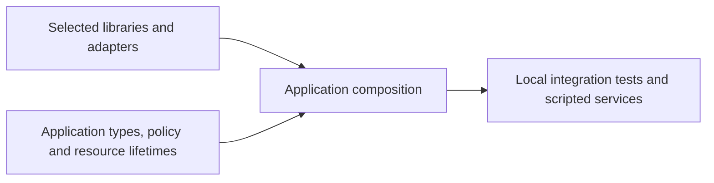

# Gleam Dream

Independent Gleam libraries for services on Erlang/OTP, plus portable session
recording and replay. Oversight is the ecosystem catalogue and a collection of
applications that exercise the libraries together.

## Libraries

Choose the packages your application needs. Each owns its API and runtime;
applications supply domain types, policy and resource lifetimes.

| Library                                                      | Use it for                                                             |
| ------------------------------------------------------------ | ---------------------------------------------------------------------- |
| [Sinal](https://github.com/gleam-dream/sinal)                | Typed native telemetry, spans and bounded forwarding                   |
| [JSON Blueprint](https://github.com/lostbean/json_blueprint) | JSON codecs, schema projection and finite runtime contracts            |
| [HTTP Gun](https://github.com/gleam-dream/http_gun)          | Pooled HTTP requests, streamed responses and cassettes                 |
| [Saga](https://github.com/gleam-dream/saga)                  | Typed dependency workflows, compensation and durable recovery          |
| [Grind](https://github.com/gleam-dream/grind)                | PostgreSQL background jobs and transactional admission                 |
| [LLM Wire](https://github.com/gleam-dream/llm_wire)          | Provider calls, typed answers, streaming and classification            |
| [Relay](https://github.com/gleam-dream/relay)                | Typed MCP servers and clients over HTTP or stdio                       |
| [Hellhound](https://github.com/gleam-dream/hellhound)        | OIDC login, OAuth tokens and access-token validation                   |
| [Correio](https://github.com/gleam-dream/correio)            | Transactional email, captured-mail tests and passwordless verification |
| [Fabric](https://github.com/gleam-dream/fabric)              | Bounded LLM agents, approvals and durable control graphs               |
| [Retrace](https://github.com/gleam-dream/retrace)            | Typed session capture, delivery and inert replay                       |

The package READMEs state release status and supported targets. Retrace includes
separate core, frontend and server packages; PostgreSQL adapters are optional
packages owned by their respective libraries.

## Choose an application

- **Payments and recovery:** [checkout](apps/checkout/README.md) composes inventory,
  payment and shipment steps; [financial recovery](apps/financial_recovery/README.md)
  combines transactional job admission with durable workflow and payment evidence.
- **Agents and tools:** [Tool Hub](apps/tool_hub/README.md) calls and serves MCP tools;
  [Support Desk](apps/support_desk/README.md) demonstrates an authenticated refund approval.
- **Sign-in and inspection:** [SSO Portal](apps/sso_portal/README.md),
  [Email Portal](apps/email_portal/README.md) and
  [Session Replay](apps/session_replay/README.md) show application-owned sessions
  and typed reconstruction.

The [application catalogue](apps/README.md) lists every runnable composition and
its boundaries. These are examples to read and adapt, rather than a shared framework.

## Run an example

From the Oversight checkout:

```sh
nix develop --command bash scripts/test-applications.sh financial_recovery
```

The command builds and tests the application using disposable PostgreSQL and a
local scripted payment provider. It needs no provider credentials or existing database.
The test below submits a payment and checks its durable outcome and account balance:

<!-- prettier-ignore-start -->

<!-- snips: apps/financial_recovery/test/financial_recovery_test.gleam#ordinary-payment -->
```gleam
pub fn ordinary_coordinator_posts_a_payment_test() {
  use f <- support.with_runtime("finance_ordinary", scripted_provider.Reply)
  let assert Ok(Nil) = payments.account(f.deps.connection, "alice", 1000)
  let assert Ok(Nil) = payments.account(f.deps.connection, "bob", 0)
  let payment = Payment(OperationId("ordinary"), "alice", "bob", 250)
  let assert Ok(coordinator.Queued(handle)) =
    coordinator.admit(f.jobs, coordinator.definition(f.deps), payment)
  assert grind.await(f.jobs, handle, within: duration.seconds(10))
    == Ok(grind.Succeeded("provider-ordinary"))
  assert payments.balance(f.deps.connection, "alice") == Ok(#(750, 0))
  assert scripted_provider.counts(f.peer.pid) == #(1, 0)
}

```

<!-- prettier-ignore-end -->

The [full application](apps/financial_recovery/README.md) supplies the domain types,
provider fixture and resource setup used by this excerpt.

## How the pieces fit



Libraries remain independent. Oversight adds no common runtime or mandatory
supervisor. The [ecosystem design](docs/design/design-layer.pdf) describes responsibility
and failure boundaries across packages.

## Experiments and evidence

Runnable applications exercise actual public APIs. The [retained experiments](playground/)
answer narrower questions; the [interface laboratory](playground/interface_lab/README.md)
contains candidate APIs and unfinished runtime boundaries, not production implementations.
Each experiment states what it can establish and how to run it.

[ORACLE.md](docs/ORACLE.md) records external references and comparison limits,
including the manual Fabric-reader experiment that requires Git history. Benchmarks
belong to the library that owns the workload, not to Oversight.

For the [application and experiment checks](AGENTS.md), use the repository's Nix
shell. The [context map](docs/CONTEXT-MAP.md) indexes the design; the
[ADRs](docs/adr/) explain decisions.
