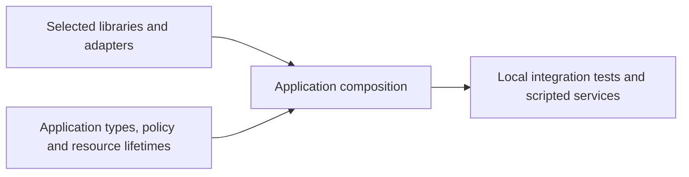

# Gleam Dream

[](https://github.com/gleam-dream/oversight/actions/workflows/ci.yml)
[](https://gleam.run/)

Independent Gleam libraries for services on Erlang/OTP, plus portable session
recording and replay. Oversight catalogues the ecosystem and exercises the
libraries together through runnable applications.

## Libraries

Choose the packages your application needs. Each owns its API and runtime;
applications supply domain types, policy and resource lifetimes.

| Library                                                      | Use it for                                                             |
| ------------------------------------------------------------ | ---------------------------------------------------------------------- |
| [Sinal](https://github.com/gleam-dream/sinal)                | Typed native telemetry, spans and bounded forwarding                   |
| [JSON Blueprint](https://github.com/lostbean/json_blueprint) | JSON codecs, schema projection and finite runtime contracts            |
| [HTTP Gun](https://github.com/gleam-dream/http_gun)          | Pooled HTTP requests, streamed responses and cassettes                 |
| [Saga](https://github.com/gleam-dream/saga)                  | Typed dependency workflows, compensation and durable recovery          |
| [Grind](https://github.com/gleam-dream/grind)                | PostgreSQL background jobs and transactional admission                 |
| [LLM Wire](https://github.com/gleam-dream/llm_wire)          | Provider calls, typed answers, streaming and classification            |
| [Relay](https://github.com/gleam-dream/relay)                | Typed MCP servers and clients over HTTP or stdio                       |
| [Hellhound](https://github.com/gleam-dream/hellhound)        | OIDC login, OAuth tokens and access-token validation                   |
| [Correio](https://github.com/gleam-dream/correio)            | Transactional email, captured-mail tests and passwordless verification |
| [Fabric](https://github.com/gleam-dream/fabric)              | Bounded LLM agents, approvals and durable control graphs               |
| [Retrace](https://github.com/gleam-dream/retrace)            | Typed session capture, delivery and inert replay                       |
| [Decisions](https://github.com/gleam-dream/decisions)        | Decision points: recommendations, verdicts and release at most once    |

The package READMEs state release status and supported targets. Retrace includes
separate core, frontend and server packages; PostgreSQL adapters are optional
packages owned by their respective libraries.

## Choose an application

- **Payments and recovery:** [checkout](apps/checkout/README.md) composes inventory,
  payment and shipment steps; [financial recovery](apps/financial_recovery/README.md)
  combines transactional job admission with durable workflow and payment evidence.
- **Agents and tools:** [Tool Hub](apps/tool_hub/README.md) calls and serves MCP tools;
  [Support Desk](apps/support_desk/README.md) demonstrates an authenticated refund approval.
- **Sign-in and inspection:** [SSO Portal](apps/sso_portal/README.md),
  [Email Portal](apps/email_portal/README.md) and
  [Session Replay](apps/session_replay/README.md) show application-owned sessions
  and typed reconstruction.

The [application catalogue](apps/README.md) lists every runnable composition and
its boundaries. These are examples to read and adapt, rather than a shared framework.

## Codecs that cross processes

A BEAM copy does not keep sharing, so a term costs its flat size each time
Grind, Fabric or Relay hands it to another process: a worker with the
dependencies its handler captures, an agent with its tool codecs, a tool list.
The applications require JSON Blueprint 2.1.1 or later and follow its
[codec practice guide](https://github.com/lostbean/json_blueprint/blob/main/docs/CODEC-PRACTICE.md):

- **Generated codec:** the extractor's Grind job payload codec,
  [`document_job_codec`](apps/extractor/src/extractor/generated/document_job_codec.gleam),
  is generated from the typed definition in
  [`document_job_definition.gleam`](apps/extractor/test/document_job_definition.gleam);
  `gleam test` fails when the definition changes and the committed module was not
  regenerated.
- **Combinators, each child codec built inside its field:** the extractor
  [invoice](apps/extractor/src/extractor/invoice.gleam#L54) (a custom date check
  and a total that depends on the decoded lines), the clinic registration
  [extraction](apps/clinic_registration/src/clinic_registration/domain.gleam#L360)
  and [card](apps/clinic_registration/src/clinic_registration/desk.gleam#L200)
  codecs, and the research agent
  [answer union](apps/research_agent/src/research_agent/domain.gleam#L135).
- **Copy-cost tests:** each high-risk application bounds the terms it hands to
  another process, as in the
  [payout desk's](apps/payout_desk/test/payout_desk/copy_cost_test.gleam); where
  a codec was fixed, a codec-size guard fails if the capture returns, as in the
  [extractor's](apps/extractor/test/copy_cost_test.gleam).

The guide's third rule is to send inputs rather than built codecs. The
applications still hand Fabric a built agent, which copies in 26 to 63 kB per run
on 2.1.1; that is an accepted cost of Fabric's current entry point.

## Run an example

From the Oversight checkout:

```sh
nix build .#financial_recovery
nix develop --command bash scripts/test-applications.sh financial_recovery
```

The Nix build uses [Gleam Nix](https://github.com/gleam-dream/gleam-nix) to compile
each locked dependency separately. Every application has a named package output;
applications with identical dependency inputs reuse the same compiled outputs.
These outputs are OTP libraries, ready for runtime or release assembly.

The test command builds and tests the application using disposable PostgreSQL and a
local scripted payment provider. It needs no provider credentials or existing database.
The test below submits a payment and checks its durable outcome and account balance:

<!-- prettier-ignore-start -->

<!-- snips: apps/financial_recovery/test/financial_recovery_test.gleam#ordinary-payment -->
```gleam
pub fn ordinary_coordinator_posts_a_payment_test() {
  use f <- support.with_runtime("finance_ordinary", scripted_provider.Reply)
  let assert Ok(Nil) = payments.account(f.deps.connection, "alice", 1000)
  let assert Ok(Nil) = payments.account(f.deps.connection, "bob", 0)
  let payment = Payment(OperationId("ordinary"), "alice", "bob", 250)
  let assert Ok(coordinator.Queued(handle)) =
    coordinator.admit(f.jobs, coordinator.definition(f.deps), payment)
  assert grind.await(f.jobs, handle, within: duration.seconds(10))
    == Ok(grind.Succeeded("provider-ordinary"))
  assert payments.balance(f.deps.connection, "alice") == Ok(#(750, 0))
  assert scripted_provider.counts(f.peer.pid) == #(1, 0)
}

```

<!-- prettier-ignore-end -->

The [full application](apps/financial_recovery/README.md) supplies the domain types,
provider fixture and resource setup used by this excerpt.

## How the pieces fit



Libraries remain independent. Oversight adds no common runtime or mandatory
supervisor. The [ecosystem design](docs/design/design-layer.pdf) describes responsibility
and failure boundaries across packages.

## Experiments and evidence

Runnable applications exercise actual public APIs. The [retained experiments](playground/)
answer narrower questions; the [interface laboratory](playground/interface_lab/README.md)
contains candidate APIs and unfinished runtime boundaries, not production implementations.
Each experiment states what it can establish and how to run it.

[ORACLE.md](docs/ORACLE.md) records external references and comparison limits,
including the manual Fabric-reader experiment that requires Git history. Benchmarks
belong to the library that owns the workload, not to Oversight.

For the [application and experiment checks](AGENTS.md), use the repository's Nix
shell. The [context map](docs/CONTEXT-MAP.md) indexes the design; the
[ADRs](docs/adr/) explain decisions.
