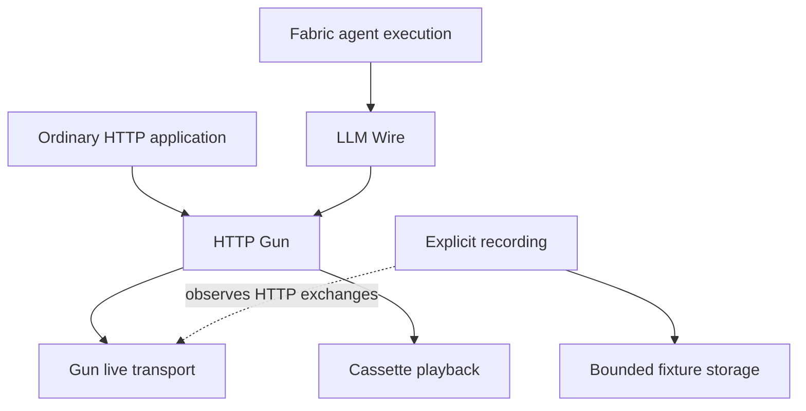

# HTTP Gun — independent HTTP client

## Decision and scope

- On 29 September 2026, the owner requested an independent Gleam HTTP client named `http_gun` built on Gun. It must serve ordinary HTTP applications and LLM Wire through the same public interface.
- This document records the package direction and required behavior. The public names below are a candidate facade; compiler probes and runtime consumer evidence have different acceptance roles. No production HTTP Gun implementation is claimed here.
- The parent is the [ecosystem plan](ECOSYSTEM-PLAN.md). The [oracle ledger](research/http-gun-oracles.md) records references and deliberate differences. The [implementation prompt](docs/implementation/http-gun-prompt.md) assigns construction and its gates.
- Production targets Erlang/OTP. Use Gun 2.6.0 and Cowlib 2.20.0 as the inspected starting baseline, with OTP 27 as the upstream minimum and OTP 28 as the current development environment. Recheck patched releases and supported OTP versions before release.
- Preserve the complete capability inventory below. An initial HTTP/1.1 milestone does not finish the assignment: the independent release requires HTTP/2, streaming, strict playback, and bounded live recording.
- Do not import LLM Wire, Fabric, Relay, Blueprint, Saga, or Grind. Ordinary requests, response bodies and fixture serialization require no JSON Schema. Observability must not require another Gleam Dream package.

## Package responsibilities

HTTP Gun owns HTTP exchange mechanics. A caller describes a request, consumes or collects the response, and chooses what the response means.

| Owner                    | Responsibility                                                                                                                                              | Excluded ownership                                                   |
| ------------------------ | ----------------------------------------------------------------------------------------------------------------------------------------------------------- | -------------------------------------------------------------------- |
| HTTP Gun                 | HTTP values, TLS, connection and stream capacity, deadlines, response bytes, local close, transport evidence, HTTP recording/playback                       | Provider outcomes, agent state, automatic application retries        |
| LLM Wire                 | Provider settings and authentication, request encoding, expected status/media type, SSE framing initially, provider reduction, tool/schema admission, usage | Sockets, HTTP pools, generic cassette storage, workflow continuation |
| Fabric or another caller | Conversation, tool execution, persistence, effect reconciliation, operation retry, transfer recovery                                                        | Gun flow credits and provider wire parsing                           |

Arrows show calls or the named observation relation. A cassette cursor tracks test playback only. It conveys no authority over external effects or Fabric execution state.

## Scenarios that establish independence

1. A command-line application sends GET and POST requests, interprets ordinary status/headers, and decodes JSON with standard Gleam functions. It has no LLM dependency.
2. A downloader reads arbitrary binary chunks without accumulating the entire body. Closing the body or losing its owner releases the request's resources.
3. A service shares a supervised client across concurrent requests. Cancelling one HTTP/2 response leaves other streams on that connection usable.
4. A test runs the same application function against a disk cassette. Missing, corrupt, mismatched or exhausted fixtures fail without contacting the network.
5. A developer explicitly records a real local HTTP exchange, commits the finished fixture, and replays it through the same response path. Failure and early close remain observable.
6. LLM Wire encodes a provider request and consumes HTTP bytes through its own bounded SSE/parser state. Selecting playback changes HTTP configuration, not the agent flow.

## Vocabulary and invariant owners

| Term              | Meaning and ownership                                                                                                                           |
| ----------------- | ----------------------------------------------------------------------------------------------------------------------------------------------- |
| Client            | An opaque reference to one explicitly started HTTP resource owner. Copies share the same pools, shutdown state and settings.                    |
| Request           | A standard Gleam HTTP request with method, origin, path/query, ordered headers and body bytes. It is a value; constructing it performs no I/O.  |
| Exchange          | One admitted request attempt and its observed response or failure. It has a local identity, not an external idempotency guarantee.              |
| Response head     | The final HTTP status and response headers observed before the body. Informational responses are distinct and cannot become the final head.     |
| Body              | An opaque capability for one response stream, with a single authoritative read/close state shared by copies.                                    |
| Stream lease      | A reservation of capacity for one exchange. It owns one H1 connection exclusively or one stream on an H2 connection.                            |
| Delivery evidence | Facts about request submission and response progress, tagged as live or playback observations. It does not prove server-side execution.         |
| Cassette          | An immutable, validated collection of versioned exchange records, independent of a live playback cursor.                                        |
| Playback session  | An explicitly started owner of a cassette's consumption order, bounded diagnostics and lifetime.                                                |
| Recording session | An owner that captures admitted HTTP observations under byte/storage limits and reports persistence completion separately from HTTP completion. |

The client owns capacity admission and shutdown. The body owner serializes reads, deadlines and local closure. The recording owner serializes fixture writes and completion. A callback, immutable value or copied handle does not independently establish any of these runtime guarantees.

## Capability inventory

| Capability                                    | Delivery class                  | Required behavior or retained scope                                                                                                                         |
| --------------------------------------------- | ------------------------------- | ----------------------------------------------------------------------------------------------------------------------------------------------------------- |
| Ordinary HTTP/1.1                             | Required independent release    | Standard Gleam methods, binary request/response bodies, status and duplicate headers, empty-body rules, final trailers, persistent reuse                    |
| Bounded buffered requests                     | Required independent release    | Collect the same streaming implementation under an explicit maximum; cleanup on every outcome                                                               |
| Response streaming                            | Required independent release    | Demand-driven byte reads, bounded buffers, copied-handle semantics, read conflicts, cancellation and owner-death cleanup                                    |
| HTTP/2                                        | Required independent release    | TLS negotiation, stream multiplexing, capacity tracking, draining, protocol-aware cancellation; explicit H1 fallback policy                                 |
| TLS and client lifecycle                      | Required independent release    | Peer/hostname verification, explicit trust configuration, supervised ownership, bounded shutdown                                                            |
| Limits, deadlines and evidence                | Required independent release    | Typed failures, one request attempt, enforceable resource budgets, phase/progress evidence                                                                  |
| Scripted HTTP and strict playback             | Required independent release    | Same HTTP response admission, typed fixture errors, exact declared matching, no network fallback                                                            |
| Live recording                                | Required independent release    | Incremental bounded capture, response fidelity, failure/close outcomes, redaction policy and atomic fixture finalization                                    |
| Diagnostics                                   | Required independent release    | Bounded mismatch reports, negotiated protocol and pool/capacity observations, no content or credential logging by default                                   |
| Streamed uploads                              | Retained follow-on scope        | Bounded producer demand, finish/abort, early response, producer failure, request replayability; no arbitrary enumerable claiming backpressure               |
| Redirect following                            | Retained follow-on scope        | Explicit opt-in, hop/deadline limit, method/body rules, origin and downgrade policy, credential stripping; redirects are ordinary responses until supported |
| Decompression                                 | Retained follow-on scope        | Explicit opt-in, encoded and decoded byte limits, bounded incremental expansion and truthful header semantics                                               |
| Proxies and client certificates               | Retained follow-on scope        | Explicit proxy/trust identity in pool keys, CONNECT and proxy credentials, mTLS; independently tested                                                       |
| Cookie jar and cache adapters                 | Retained follow-on scope        | Optional caller-owned policy/storage, explicit lifetime and bounds; no ambient global jar or cache                                                          |
| Generic SSE helper                            | Retained follow-on scope        | Pure framing separate from HTTP bytes; keep LLM framing where it is during initial extraction                                                               |
| WebSockets, HTTP/3, server framework          | Outside this package assignment | Separate protocols or packages; Gun support alone does not add public scope                                                                                 |
| Automatic request retry and transfer recovery | Outside core ownership          | Caller chooses retry; Range/If-Range, Last-Event-ID and upload recovery require application-aware policy                                                    |
| Agent continuation/checkpoints                | Outside this package            | Fabric or the application owns execution persistence                                                                                                        |

## Public interface direction

Follow [the public API guidelines](PUBLIC-API-GUIDELINES.md). Use qualified module functions, standard Gleam HTTP types, explicit Results, and opaque live capabilities. Avoid Dynamic, raw Gun options, process IDs, sockets, stream references and callback state parameters in ordinary callers.

| Module            | Candidate surface                                                            | Contract                                                                            |
| ----------------- | ---------------------------------------------------------------------------- | ----------------------------------------------------------------------------------- |
| http_gun          | settings/defaults, start, stop, send, open, with_response, next, close, info | One client and one owned body interface; settings are pure and start is explicit    |
| http_gun/testing  | scripts and controlled transport faults                                      | Deterministic generic HTTP responses, including head/body/trailers/terminal failure |
| http_gun/cassette | new/parse/load, playback, record, finish                                     | Fixture values, explicit execution sessions and fallible finalization               |

- Reuse `gleam/http/request.Request(BitArray)` and `gleam/http/response.Response(body)`. Preserve status and ordered duplicate headers; normalize header names according to Gleam HTTP's convention.
- Candidate `open` returns a response with an opaque Body after final headers. `next` returns a byte chunk, end with trailers, or a typed read/failure outcome.
- Candidate `send` returns a buffered response plus trailers and negotiated-protocol metadata. Do not drop trailers to force a narrower return type.
- Both paths use one admitted request, one transport path and one body owner. A failed collection closes the body. A caller can consume one streaming body only once.
- Supply a scoped response helper that closes on normal return, Error, early return and supported exception exits. Monitor the body owner for process loss. Ordinary callers must not need a separate cleanup engine.
- Expose protocol preference as named variants: HTTP/1.1 only, prefer HTTP/2 with H1 fallback, or require HTTP/2. Unsupported negotiation fails explicitly.
- Keep settings meaningful: connection/stream caps, trust/protocol policy and phase deadlines. Expose low-level protocol tuning only for an evidenced use case through a validated advanced contract.
- Live, strict playback and recording must yield the same HTTP client contract. Resolve environment selection at application startup. Do not read environment variables inside request execution.
- LLM Wire's intended integration is one supplied HTTP client. Provider preparation must still reject invalid requests before the HTTP client can send them.
- Public names remain reviewable until a separate consumer proves the common task, advanced configuration, caller-owned data/errors and failure handling. The construction agent must retain this consumer and compile-negative fixtures in its release gate.

## HTTP exchange behavior

- Support all methods represented by the selected Gleam HTTP version. Validate headers, origin, port, target and body limits before sending. Invalid configuration allocates no networking resources.
- Treat 2xx, redirects, 4xx and 5xx as response data. A successfully received 429 is not a transport failure. Preserve Retry-After as a header; provider-specific interpretation belongs to the caller.
- Follow HTTP empty-body rules for HEAD and statuses such as 204/304. Content-Length and transfer framing belong to the protocol implementation; conflicting framing must not become an ambiguous reusable connection.
- Distinguish informational responses from the final response; bound their count/size. Protocol upgrades outside the supported contract fail explicitly.
- Preserve response head, arbitrary body bytes and trailers. Do not require UTF-8, JSON, SSE, a model, a tool catalog or a successful status.
- The initial release does not automatically follow redirects or decompress content. It returns redirects and encoded bytes with truthful headers. LLM Wire can require identity encoding and SSE above this contract.
- For HTTPS, verify certificates and hostname using the configured trust source. Do not silently downgrade verification or negotiate plaintext after a TLS failure.
- The generic library supports explicit HTTP endpoints and custom trust for normal applications. LLM Wire retains its stricter endpoint policy.
- Default to no cookies, no HTTP cache and one request attempt. Gun reconnection must never silently resend an exchange. Delivery uncertainty remains visible.

## Client, connection and body lifecycle

### Client and pool

| Current state | Trigger and guard                                 | Next state and outcome                                           |
| ------------- | ------------------------------------------------- | ---------------------------------------------------------------- |
| Not started   | Valid settings and successful startup             | Running client; no request is sent by configuration construction |
| Running       | Admitted exchange and capacity available          | Acquire one stream lease; request deadline includes pool wait    |
| Running       | Capacity exhausted, waiter budget available       | Queue a bounded waiter until capacity, deadline or caller death  |
| Running       | Waiter budget exhausted                           | Typed capacity failure; no request sent                          |
| Running       | stop                                              | Stop new admission; begin bounded draining                       |
| Draining      | Active work finishes or shutdown deadline expires | Closed; close remaining work with explicit local outcome         |
| Closed        | Request or repeated stop                          | Request fails as client closed; stop is idempotent               |

- Pool keys include origin and all connection-affecting policy (TLS trust/client identity, protocol selection and proxy route when supported). Incompatible settings cannot share a connection.
- For H1, reuse a healthy idle connection before opening another. The initial policy does not pipeline independent requests.
- For H2, reuse healthy available stream capacity before opening another connection. Respect peer capacity, local caps, stream exhaustion and draining/GOAWAY.
- Count active connections, connecting attempts, queued admissions and active streams separately. Cap origins as well as resources per origin and globally.
- A single stream failure or local cancellation must not close healthy H2 siblings. Connection failure fails all affected streams with their own delivery evidence.
- A draining connection accepts no new streams. GOAWAY may establish that some requests were not processed, but the core still returns evidence rather than replaying them.
- Startup, stop and supervision must compose with a normal OTP application. No global registered singleton, environment-driven settings or unrelated client termination.

### Body

| Current state           | Trigger and guard                         | Next state and outcome                                                       |
| ----------------------- | ----------------------------------------- | ---------------------------------------------------------------------------- |
| Open                    | next with no pending read                 | Reading; bounded demand issued                                               |
| Reading                 | A second read from a copied handle        | Unchanged; typed read-conflict error                                         |
| Reading                 | Chunk accepted for the pending read       | Open; chunk delivered once                                                   |
| Reading                 | Local read wait expires                   | Open; no accepted chunk is lost; operation deadline remains authoritative    |
| Open or Reading         | HTTP EOF with admitted trailers           | Ended; terminal end delivered once                                           |
| Open or Reading         | Transport/protocol/limit/deadline failure | Failed; failure evidence retained; lease released                            |
| Open or Reading         | close or owner death                      | Closed; local cancellation and cleanup                                       |
| Ended, Failed or Closed | next                                      | Typed closed/terminal result; no further chunk delivery                      |
| Any terminal state      | close                                     | Idempotent success; no repeated cleanup or fabricated remote acknowledgement |

- Body copies share the same owner. Immutable cursor copies must not duplicate data or fork consumption.
- Define one consuming process per body in the initial release. Transfer to another process requires a documented, explicit handoff operation if added; passing a handle alone does not transfer ownership.
- Arbitrate timeout, chunk arrival, EOF and close in one owner. A read timeout must not silently discard a chunk already accepted for delivery.
- Close means local resource release. H2 cancellation requests protocol stream cancellation; it does not establish that the server stopped computing or rolled back an effect.
- Buffered collection and scoped streaming use the same lifecycle. Caller death, request-owner death, transport death and client shutdown have explicit cleanup paths.

## Bounds and deadlines

A named byte limit must state where it is enforced. Admission after allocation, retained-buffer bounds and a total process-memory bound are different claims.

| Budget                        | Required enforcement and evidence                                                                                                      |
| ----------------------------- | -------------------------------------------------------------------------------------------------------------------------------------- |
| Request bytes and headers     | Check before sending; upload extensions separately bound the producer and in-flight data                                               |
| Response headers and trailers | Count and aggregate bytes; reject oversized complete and fragmented blocks; audit parser enforcement before assembling unbounded input |
| Body bytes                    | Per-chunk, queued-byte and optional total-transfer caps; buffered send always has a finite collection maximum                          |
| H2 receive windows            | Bound stream and connection windows jointly with active-stream caps and mailbox retention                                              |
| Semantic data                 | Outside HTTP Gun; LLM Wire retains line, SSE event, tool argument and provider metadata limits                                         |
| Cassette input/output         | File size before decoding, decoded byte totals, nesting, exchange/chunk count and diagnostic history                                   |
| Recording storage             | Bounded writer demand, per-exchange and per-session byte limits, file handles and pending writes                                       |
| Time                          | Pool wait, DNS/connect/TLS, response-head, idle read, overall operation and shutdown budgets                                           |

- Use one monotonic overall deadline across admission, connection and response. Subphase limits cannot reset or extend it.
- Distinguish a caller's wait timeout from an exchange deadline. Define idle-time behavior while the caller intentionally stops reading; do not silently infer a transfer-resumption promise.
- Gun flow credit limits delivery activity but is not a byte bound. Pinned Gun H2 can deliver data already permitted by its receive windows after credit is exhausted; its inspected default windows are 8,000,000 bytes.
- Match initial credit to body-owner demand so attaching a transport cannot add an unaccounted extra grant. Test the real opening handshake, not only a fake callback counter.
- Existing LLM Wire rejects complete oversized headers after Gun parsing. Its trailer handler discards trailers without an adapter-level size measurement. Reproduce and repair these gaps before claiming the corresponding bounds.
- Gun/Cowlib parser constraints remain a release gate. If the required parser bound needs upstream changes, retain a reproducible failing case and a narrowly scoped, licensed patch proposal or patched dependency. Do not weaken the guarantee or claim that an adapter check prevents an earlier allocation.
- Streaming a large response may retain bounded memory while transferring many bytes. Make the total-transfer cap explicit; disabling it never disables per-buffer, header, window or recording bounds.

## Failures and delivery evidence

- Use closed typed variants for validation, client closure, capacity, timeout phase, TLS/connection failure, protocol failure, size limit, read conflict, body closure and cassette/storage failures.
- Preserve bounded diagnostic detail and relevant observed facts. Callers must not parse an error string to decide whether a request may have been sent.
- Evidence records whether a request was not sent or may have been sent, whether final response headers were received, and response-byte progress. No delivery flag proves that a remote effect happened exactly once.
- Tag evidence with Live or Playback origin. Playback may reproduce recorded logical failure/progress for application tests, but must never represent those facts as physical network activity in the current run.
- A completed HTTP response remains distinct from a recording finalization failure. Preserve both outcomes if storage fails after the remote request might already have succeeded.
- Preserve non-success HTTP headers and bounded bodies for caller interpretation. Do not collapse all status responses into one transport error.

## Cassette values, playback and recording

### Exchange format and matching

- Use a versioned JSON envelope with explicit binary encoding for bodies/chunks and stable terminal tags. Ordinary JSON is sufficient; do not depend on Blueprint.
- Store the effective request identity (method, scheme/host/port, target including query, selected headers and exact body) and response observations (final status, headers, chunks, trailers and terminal outcome).
- Represent failure before final headers without inventing a response head. A partial response retains only observations actually admitted before its failure or local close.
- Define canonicalization once. Normalize only declared equivalences; retain query/body byte order unless the caller explicitly chooses a different matching policy.
- Default to exact ordered matching after the declared redaction/normalization policy. Missing, malformed, unsupported, oversized, mismatched and exhausted fixtures fail explicitly; they never authorize live I/O.
- A mismatch does not consume the expected exchange. Repeated identical requests may receive distinct responses at distinct positions. Do not silently replace this with first-match or unordered matching.
- Matching must include semantically relevant selected headers. Excluding credentials must not erase content negotiation or conditional-request behavior.
- Preserve duplicate headers and arbitrary body bytes. Invalid fixture tags, malformed base64 and incompatible versions are typed failures; malformed data must not become an empty successful response.
- The new HTTP format does not claim Dream or ReqCassette file compatibility. Current LLM v1 fixtures require a declared converter or explicit incompatibility response, never ambiguous auto-detection.

### Playback lifecycle

- Loading and validating a Cassette is separate from starting a playback session. The immutable value contains no process, client, credentials, live socket or cursor.
- Starting playback performs no network I/O. Each matching admission atomically reserves the next exchange for one request; body consumption cannot reassign it.
- Scope each sequence to one test or flow by default. Shared concurrent sequences follow admission order and must not claim schedule-independent response assignment.
- Add named lanes only when a real parallel test requires them. A lane owns its sequence; a global callback or mutable process dictionary must not select the active cassette.
- Bound recorded attempts and mismatch diagnostics, including repeated failures. A finite input fixture alone does not bound an indefinitely reused history list.
- Playback enters the same HTTP head/body/trailer admission and body-owner contract as live transport. It cannot bypass content-length, byte-limit or terminal-state validation.
- A recorded failure or local cancellation yields that explicit outcome. Preserving chunk segmentation does not promise original TCP packets or scheduler timing.

### Recording lifecycle

| Current state        | Trigger                              | Next state and contract                                                                   |
| -------------------- | ------------------------------------ | ----------------------------------------------------------------------------------------- |
| Recording            | Admitted request/head/chunk/trailers | Append bounded validated observations through the writer's demand contract                |
| Recording            | HTTP EOF                             | Exchange complete; record admitted trailers and Complete                                  |
| Recording            | Transport failure or local close     | Exchange finalized as Failed or LocallyCancelled; never synthesize Complete               |
| Recording            | Writer failure or recording limit    | Capture failed; stop further capture and signal typed failure with HTTP delivery evidence |
| Recording            | finish with active exchanges         | Reject as busy; caller completes/cancels them first                                       |
| Recording            | finish with all exchanges finalized  | Flush/close and atomically publish a validated cassette; return persistence result        |
| Finished             | Repeated finish                      | Same committed result; no duplicate overwrite                                             |
| Any unfinished state | Process loss                         | Temporary/abandoned capture is not a valid completed cassette                             |

- Recording is explicit live I/O; playback is explicit offline I/O. Do not implement “record if missing” or fallback modes in the required release.
- A recording client that wraps a live client borrows its transport resources. Stopping the recording client does not stop unrelated work on the live client; stopping the live client terminates dependent exchanges explicitly. Document which handles the caller must stop.
- Reserve recording positions at request admission, before responses can complete out of order. Bound simultaneous unfinished records and retain the admitted sequence in the committed fixture. Shared concurrent playback still follows the admission-order rule above.
- Capture HTTP observations before provider decoding and before optional future decompression. HTTP Gun must not know when an LLM is semantically finished.
- An LLM may close after its terminal event and before HTTP EOF. Keep that local cancellation in the recording; do not secretly drain the response to obtain a Complete record.
- Incremental storage participates in demand. A slow writer must not accumulate an unbounded mailbox or copy a complete large body before saving.
- Default to removing authorization and cookie credentials from both request and response metadata. Provide explicit policies for other headers, query values and bodies; bodies are not automatically sanitized.
- Apply the same declared transformation to persisted matching data and incoming playback identities without mutating the live request. Redaction must preserve protocol validity or reject the fixture; recompute derived lengths when bytes change.
- Byte-stream redaction must handle split tokens. A transform requiring the whole body needs an explicit finite buffering bound; do not claim a naive per-chunk replacement is safe.
- Finish reports atomic file publication separately from HTTP completion. Specify durability against process crash versus machine/power loss; do not imply fsync guarantees from rename alone.
- Do not overwrite an existing fixture by default. Replacement requires an explicit caller choice. Store only stable data, never Erlang terms, closures, PIDs or authentication configuration.

## Extraction and consumer migration

The existing implementation is a source donor, not a runtime dependency of HTTP Gun.

| Existing LLM Wire area                                        | Destination or adaptation                                                                          |
| ------------------------------------------------------------- | -------------------------------------------------------------------------------------------------- |
| Gun bridge, pool and TLS mechanics                            | Generalize under HTTP Gun; remove POST/SSE/provider assumptions                                    |
| Transport delivery evidence and byte deadlines                | HTTP Gun types; LLM Wire maps them to provider outcomes                                            |
| Stream owner                                                  | Separate HTTP body state from SSE/provider/semantic queue state; do not duplicate the entire actor |
| Strict scripts and cassette file handling                     | HTTP Gun generic test/cassette modules with a new complete HTTP model                              |
| testing.text/tool_calls/refusal                               | Stay in LLM Wire and compose generic HTTP scripts                                                  |
| Provider parsing, tool/schema validation and retry assessment | Stay in LLM Wire                                                                                   |
| Conversation/persistence                                      | Fabric or caller; no new HTTP continuation API                                                     |

- LLM Wire retains invalid-request admission before HTTP execution. HTTP Gun must compile and test without any LLM source directory present.
- Keep at least one ordinary HTTP consumer and one LLM integration consumer. A transport passing only an LLM happy path does not establish independence.
- Retain TLS, read-race, cleanup, strict-matching and provider correctness tests at their actual owning boundary. Move generic assertions once; retain a small integration suite proving composition.
- Do not alter Fabric, Relay or other consumers during the initial construction assignment. Supply migration examples and a separate LLM Wire integration plan; test integration in an isolated consumer or disposable checkout.
- The older deferred Dream adoption note remains historical. This decision selects an independent Gun-based package, not adoption or modification of Dream.

## Validation and evidence

Use TDD for each observable family: a meaningful failing public test, the smallest implementation, then refactoring. Compilation-only fixtures cannot establish network, lifetime or memory guarantees.

| Family         | Required acceptance cases                                                                                                                                      |
| -------------- | -------------------------------------------------------------------------------------------------------------------------------------------------------------- |
| HTTP semantics | GET/HEAD/POST and other supported methods; binary bodies; 201/204/304/429/500; duplicate headers, informational responses, trailers, malformed framing         |
| Lifecycle      | Copied handles, conflicting reads, chunk/timeout/close races, caller/owner death, client shutdown, terminal delivery and lease cleanup                         |
| Bounds         | Exact edges; complete and fragmented oversized heads/trailers; large download without collection; slow consumer and slow recorder; bounded diagnostics         |
| TLS and pool   | Certificate/hostname rejection, explicit trusted CA, trust-policy isolation, sequential reuse, bounded origins/connections/streams/waiters                     |
| HTTP/2         | Verified negotiation and shared socket; sibling cancellation; peer SETTINGS capacity changes; GOAWAY/draining; reset and connection loss                       |
| Delivery       | Failure before send, ambiguous POST failure, partial response, no hidden replay, recorded versus live evidence                                                 |
| Cassette       | Binary round trip, strict sequence and selected headers, mismatch without consumption, corruption/version rejection, exhaustion, no network fallback           |
| Recording      | Real local-server capture to playback; Complete/Failed/LocallyCancelled; writer failure, crash before finish, atomic commit, redaction across chunk boundaries |
| Independence   | Fresh package build without sibling libraries; external public consumer for common/advanced/error paths; negative opaque-handle checks                         |
| Performance    | Reproducible local H1/H2 runs at 1/10/100/1000 concurrent streams where feasible; report socket counts, memory/mailboxes and latency with environment limits   |

- Gun/Cowlib source and protocol requirements are authoritative for transport behavior. Dream, ReqCassette, Mint, Finch and Gleam HTTPc are scoped references; no complete behavioral parity claim is intended.
- Maintain a per-case oracle ledger with revision/license, upstream path/test, expected observation, local test, comparison normalization, evidence class and deliberate differences.
- Distinguish source inspection, inspired tests, faithful ports and differential execution. Run selected upstream cases when useful and feasible. An unavailable oracle is unverified, not passing.
- Use local HTTP/TLS/H2 servers and explicit synchronization for normal gates. Do not require provider credentials or public Internet requests.
- Keep parser-bound proof and performance measurements separate from ordinary unit tests. Never infer an H2 guarantee from two H1 sockets or a scripted event source.

## Pending implementation

| Kind  | Item                                     | Completion condition                                                                             |
| ----- | ---------------------------------------- | ------------------------------------------------------------------------------------------------ |
| build | Independent package and candidate facade | Public consumer and production implementation pass the stated gates without sibling dependencies |
| build | Parser/header/trailer hardening          | Reproduced cases, bounded implementation and documented dependency decision                      |
| build | H2 capacity and demand                   | Real shared-connection tests and measured resource bounds                                        |
| build | Generic cassette and recorder            | Complete HTTP fidelity, explicit modes, bounded persistence and round-trip evidence              |
| build | LLM Wire adoption                        | Separate migration preserves provider admission, semantics and limits through public imports     |

No pending item grants permission to mark a reduced slice as the completed independent release.
