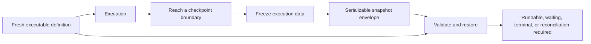

<!-- THROWAWAY: Can one typed workflow model compose agents, approval, and restore? -->

# Ecosystem interface playground

This laboratory tests candidate typed APIs. Its `lab/` modules are sketches,
not the production packages, and must not be published as implementations.

The main experiment combines an agent call, approval suspension, a compensating
child workflow and a restorable continuation in one typed workflow. Smaller
consumers exercise the supporting interfaces independently.

The [ecosystem design](../../docs/design/design-layer.pdf) owns composition
contracts; each package owns its implemented design. [ADR 0009](../../docs/adr/0009-retain-executable-evidence-with-scoped-claims.md)
explains why these prototypes remain as scoped evidence.

## Run the experiment

From the repository root:

```sh
nix develop --command python3 playground/interface_lab/check.py
```

The command compiles the positive sources, compiles each consumer with only its transitive source imports, and checks each negative example in an isolated temporary project. A negative example passes only when the compiler rejects it with the expected diagnostic. The project uses the repository's Gleam 1.18.1 toolchain and has no external package dependencies.

The command also executes interface probe groups through `stress_checks`: codec composition, retained approval input, batch results, injected job dependencies, contextual tools, scripted provider turns, derived tool catalogs, foreign observation data, and graph construction. It does not execute scheduler, storage, protocol, or other unfinished runtime boundaries.

Named `todo` expressions identify unfinished runtime boundaries and produce expected compiler warnings. Running those functions would panic. The absence of production implementations is intentional; warnings-as-errors is not the acceptance gate for this experiment.

## Inspect the interfaces

| Surface            | Location                                            | Experiment                                                                       |
| ------------------ | --------------------------------------------------- | -------------------------------------------------------------------------------- |
| Shared data        | `src/lab/value.gleam`, `src/lab/blueprint.gleam`    | Bidirectional typed codecs around an explicit data algebra                       |
| Workflow authoring | `src/lab/saga.gleam`                                | One typed definition, explicit execution capabilities, child boundaries          |
| Freeze/thaw        | `src/lab/saga_checkpoint.gleam`                     | Execution state, checkpoint permission, untrusted snapshot, restoration outcomes |
| Durable execution  | `src/lab/grind.gleam`, `src/lab/saga_grind.gleam`   | Worker registration, submission, run handles, signals and cancellation           |
| Agent integration  | `src/lab/fabric.gleam`, `src/lab/fabric_turn.gleam` | Contextual tools and explicit pending tool-result batches                        |
| Model call         | `src/lab/llm.gleam`, `src/lab/llm_turn.gleam`       | One-call provider interface, typed output, and provider-owned continuation       |
| Protocol tools     | `src/lab/relay.gleam`                               | Heterogeneous tool packaging without a workflow dependency                       |
| Observation        | `src/lab/sinal.gleam`                               | One descriptor constrains measurements and metadata                              |
| Authentication     | `src/lab/warden.gleam`                              | Canonical verified identity follows configured backend and binding checks        |

The workflow consumer is the primary example. The other consumers isolate model calls, login, observation, and function reuse across adapters. They are caller examples, not production usage documentation.

## Freeze and restore



A definition contains code and typed codecs. A snapshot contains data identifying the definition and recording execution progress. The snapshot must not contain a closure, actor, socket, or live worker lease as an executable resource. Restore receives a fresh definition and validates persisted data against it.

A checkpoint capability distinguishes an execution that may be frozen from one that is still running. It does not prove exclusive ownership: Gleam values can be copied. Concurrent runner exclusion, commit ordering, stale revisions, and signal deduplication need runtime checks.

Approval is a suspension point rather than a blocked worker. A durable implementation must commit its wait state and release capacity. An uncertain external effect remains uncertain after freeze/thaw; restoring a snapshot cannot establish whether a remote payment happened.

## What the evidence can establish

Constructive representations retain the values needed by their interfaces. Codecs contain encoder/decoder functions, and tool registrations capture handlers with their codecs. Heterogeneous tool lists therefore have an actual representation without `Dynamic`.

Compiler checks can reject incompatible types, distinguish execution capabilities and native child result types, and prevent a pending identity from entering a verified-identity API. They cannot prove codec laws, graph validity, persistence safety, authorization, idempotency, or correct scheduling.

The `fabric` wrapper stores a caller-supplied function and a tool registry. Its invocation calls that function; this does not implement tool calling or enforce a loop bound. The `fabric_turn` module exercises explicit tool-request/result handoff with scripted providers. The model provider is an injected function, not a provider compatibility implementation. The small data algebra is not a JSON parser. Blueprint emits a finite JSON Schema subset; independent validation covers the recorded corpus rather than full dialect conformance.

Compiling isolated source imports tests module dependency direction. All modules still belong to one experimental package; independently distributable packages require later consumer builds against actual package boundaries.

## Outside this experiment

- Full DAG authoring, shared dependencies, branching, cycles, dynamic graph validation, and definition migrations.
- Executable freeze/thaw, JSON byte roundtrips, revision checks, signal authentication and deduplication, crash recovery, and compensation races.
- Provider-specific continuation, streaming cancellation/backpressure, and interruption inside a running agent.
- Full schema support, telemetry interoperability, MCP conformance, OIDC correctness, upstream oracle suites, and benchmarks.

A successful type check establishes none of these runtime guarantees. The
production libraries and their designs describe the implemented APIs.
