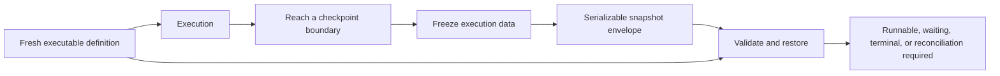

<!-- THROWAWAY: Can one typed workflow model compose agents, approval, and restore? -->

# Ecosystem interface playground

This is a retained, disposable type experiment. It is not an implementation of the proposed packages and must not be published as one. The `lab/` module names identify candidate responsibilities, not settled package APIs.

The primary question is whether one typed workflow model can express a bounded agent call, approval suspension, a compensating child workflow, and a restorable continuation while keeping execution capabilities explicit. Smaller consumer examples check whether the supporting interfaces remain useful independently.

Read the [findings](FINDINGS.md) for the verified results and the representation corrections discovered during review. Start with the [workflow consumer](src/consumers/workflow.gleam) and the [freeze/thaw consumer](src/consumers/checkpoint.gleam) to inspect the proposed caller experience.

The subsequent [public-interface stress exploration](STRESS-TESTS.md) covers 22 individual-library and cross-library scenarios. It records the expanded checks, small API corrections, and the contracts that are still missing.

The [codec-derived catalog refinement](SCHEMA-CATALOG.md) connects supported codec schemas to package-specific tool discovery and dispatch.

The [observation contract refinement](OBSERVATION-CONTRACT.md) separates map-shaped event fields from arbitrary codecs and checks foreign-data failure classification.

The [shared graph refinement](SHARED-GRAPH.md) tests typed references, shared producers, joins, reusable children, and copied-builder membership. See the [current refinement status](REFINEMENT-STATUS.md) for the cross-package evidence map.

The [closed-choice refinement](CLOSED-CHOICE.md) adds typed approval/decline routing with explicit output encoding and private branch internals.

The [activity-contract refinement](ACTIVITY-CONTRACT.md) replaces the positional version cluster with reusable typed boundaries.

The [execution-ownership refinement](EXECUTION-OWNERSHIP.md) distinguishes direct activities and approvals from independently managed children.

The [login-transaction refinement](LOGIN-TRANSACTIONS.md) checks concurrent callback binding without issuing verified identities.

## Run the experiment

From the repository root:

```sh
nix develop --command python3 playground/interface_lab/check.py
```

The command compiles the positive sources, compiles each consumer with only its transitive source imports, and checks each negative example in an isolated temporary project. A negative example passes only when the compiler rejects it with the expected diagnostic. The project uses the repository's Gleam 1.18.1 toolchain and has no external package dependencies.

The command also executes interface probe groups through `stress_checks`: codec composition, retained approval input, batch results, injected job dependencies, contextual tools, scripted provider turns, derived tool catalogs, foreign observation data, and graph construction. It does not execute scheduler, storage, protocol, or other unfinished runtime boundaries.

Named `todo` expressions identify unfinished runtime boundaries and produce expected compiler warnings. Running those functions would panic. The absence of production implementations is intentional; warnings-as-errors is not the acceptance gate for this experiment.

## Inspect the interfaces

| Surface            | Location                                            | Experiment                                                                       |
| ------------------ | --------------------------------------------------- | -------------------------------------------------------------------------------- |
| Shared data        | `src/lab/value.gleam`, `src/lab/blueprint.gleam`    | Bidirectional typed codecs around an explicit data algebra                       |
| Workflow authoring | `src/lab/saga.gleam`                                | Typed composition, local versus persistence-ready definitions, child boundaries  |
| Freeze/thaw        | `src/lab/saga_checkpoint.gleam`                     | Execution state, checkpoint permission, untrusted snapshot, restoration outcomes |
| Durable execution  | `src/lab/grind.gleam`, `src/lab/saga_grind.gleam`   | Worker registration, submission, run handles, signals and cancellation           |
| Agent integration  | `src/lab/fabric.gleam`, `src/lab/fabric_turn.gleam` | Contextual tools and explicit pending tool-result batches                        |
| Model call         | `src/lab/llm.gleam`, `src/lab/llm_turn.gleam`       | One-call provider interface, typed output, and provider-owned continuation       |
| Protocol tools     | `src/lab/relay.gleam`                               | Heterogeneous tool packaging without a workflow dependency                       |
| Observation        | `src/lab/sinal.gleam`                               | One descriptor constrains measurements and metadata                              |
| Authentication     | `src/lab/warden.gleam`                              | Pending login cannot be used as verified identity                                |

The workflow consumer is the primary example. The other consumers isolate model calls, login, observation, and function reuse across adapters. They are caller examples, not production usage documentation.

## Freeze and restore



A definition contains code and typed codecs. A snapshot contains data identifying the definition and recording execution progress. The snapshot must not contain a closure, actor, socket, or live worker lease as an executable resource. Restore receives a fresh definition and validates persisted data against it.

A checkpoint capability distinguishes an execution that may be frozen from one that is still running. It does not prove exclusive ownership: Gleam values can be copied. Concurrent runner exclusion, commit ordering, stale revisions, and signal deduplication need runtime checks.

Approval is a suspension point rather than a blocked worker. A durable implementation must commit its wait state and release capacity. An uncertain external effect remains uncertain after freeze/thaw; restoring a snapshot cannot establish whether a remote payment happened.

## What the evidence can establish

Constructive representations retain the values needed by their interfaces. Codecs contain encoder/decoder functions, and tool registrations capture handlers with their codecs. Heterogeneous tool lists therefore have an actual representation without `Dynamic`.

Compiler checks can reject incompatible types, distinguish local plans from durable definitions, and prevent a pending identity from entering a verified-identity API. They cannot prove codec laws, graph validity, persistence safety, authorization, idempotency, or correct scheduling.

The original agent wrapper stores a caller-supplied function and a tool registry. Its invocation calls that function; this does not implement tool calling or enforce a loop bound. The newer `fabric_turn` module exercises explicit tool-request/result handoff with scripted providers. The model provider is an injected function, not a provider compatibility implementation. The small data algebra is not a JSON parser or a JSON Schema implementation.

Compiling isolated source imports tests module dependency direction. All modules still belong to one experimental package; independently distributable packages require later consumer builds against actual package boundaries.

## Deliberately unresolved

- Full DAG authoring, shared dependencies, branching, cycles, dynamic graph validation, and definition migrations.
- Executable freeze/thaw, JSON byte roundtrips, revision checks, signal authentication and deduplication, crash recovery, and compensation races.
- Provider-specific continuation, streaming cancellation/backpressure, and interruption inside a running agent.
- Full schema support, telemetry interoperability, MCP conformance, OIDC correctness, upstream oracle suites, and benchmarks.

These are follow-on experiments, not guarantees implied by a successful type check. Keep this playground here for inspection and revision; promote only learned contracts into the package designs after review.

## Next executable question

After reviewing these interfaces, use one fixed checkout flow to ask whether a committed suspension can survive process loss without losing ownership of effects. This would be a separate, deliberately small runtime experiment:

1. Reach approval, encode a real snapshot, discard the process, and reconstruct the definition from fresh code.
2. Decode and validate the snapshot, then race duplicate approval commands against a compare-and-set store. Exactly one revision may advance.
3. Inject a crash after a fake payment ledger records its effect but before workflow completion is recorded. Restore must require reconciliation unless the declared idempotency contract resolves the ambiguity.
4. Resolve the outcome, fail a later step, and restart during compensation. Check the journal's compensation admission and ordering independently of remote effect guarantees.

That experiment would test the freeze/thaw proposal. The current compiler experiment does not perform these steps.
