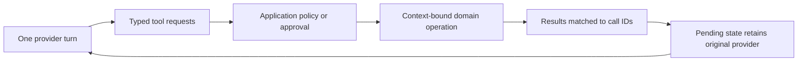

<!-- THROWAWAY: Can small public interfaces support independent and unexpected compositions? -->

# Public interface stress exploration

## Scope

The checkpoint for the first interface experiment is commit `fb7d408`. This exploration challenges that API with individual-package and cross-package scenarios. It distinguishes a caller that can be expressed now from an absent interface or a runtime guarantee that has not been demonstrated.

The brainstorming passes covered 22 scenarios. The implementation probes deliberately remain small. A successful compiler run is not evidence that all requested capabilities of the production libraries exist.

The later [codec-derived catalog refinement](SCHEMA-CATALOG.md) addresses part of the schema/discovery gap below. The counts in this report describe its historical checkpoint.

## Verified evidence

On 2026-09-19 with Gleam 1.18.1, all fourteen source-isolated consumers compiled and all fourteen negative examples failed with their intended type errors. Six pure probe groups also executed successfully: configuration codecs and error paths, retained approval input, offline batch outcomes, injected job dependencies, shared tenant registries, and two scripted provider/tool continuations. No unfinished runtime boundary was executed.

The native `gleam-lsp` tools are now loaded in the session and were used to inspect affected public surfaces. Compiler checks remain the acceptance evidence.

## Scenario matrix

| Scenario                                                         | Libraries used                | Result of the interface exploration                                                                                                                                                                                                    |
| ---------------------------------------------------------------- | ----------------------------- | -------------------------------------------------------------------------------------------------------------------------------------------------------------------------------------------------------------------------------------- |
| Read CLI configuration from JSON, environment, or another parser | Blueprint alone               | A parser can produce `Value`; decoding is independent of transport and application execution. `config_codec` constructs a domain codec. Precedence and duplicate-key policy remain parser/application responsibilities.                |
| Import many records and report exact invalid locations           | Blueprint alone               | Added recursive field/index errors plus `pair` and `imap`. A caller can retain row IDs and prefix paths without parsing human error messages. Error accumulation remains an application choice.                                        |
| Export a tool catalog without running any handler                | Blueprint + Relay             | Missing: the codec has no derived schema and Relay has no discovery API. Manual schema declarations are not evidence of codec/schema agreement.                                                                                        |
| Extract typed records with interchangeable model providers       | Blueprint + LLM               | Client-side decoding works. The toy provider-turn declaration carries schema data, but provider-enforced structured output and schema dialect negotiation remain unimplemented.                                                        |
| Stream text with interleaved tool arguments and cancel midway    | LLM alone                     | Missing stream/resource API. The buffered turn experiment does not establish chunk ordering, backpressure, cancellation, or cleanup.                                                                                                   |
| Fail over a model call and continue its conversation             | LLM alone                     | Ordinary wrappers can choose providers before output. Continuation compatibility is not automatic. Fabric pending state now retains the originating provider to prevent accidental switching.                                          |
| Reuse a registered tool across tenants and request identities    | Relay alone or Relay + Warden | Added `ContextTool(c)` so registration and invocation context are separate. Application policy runs before the domain operation. Protocol discovery/visibility and MCP bearer-token verification are still separate work.              |
| Expose one business function as an MCP tool, agent tool, and job | Relay + Fabric + Grind        | Existing closures work for fixed context. Context-aware registrations support request-time context; job payloads carry identifiers and the deployed worker reloads its authorization context. No universal task type is needed.        |
| Run two login providers and concurrent browser tabs              | Warden alone                  | Missing configured client, authorization redirect, transaction store, expiry, and replay contracts. The current pending/verified distinction is useful but far from a complete login interface.                                        |
| Use web login and protected MCP in the same deployment           | Warden + Relay                | Separate application adapters are appropriate. A verified web identity is not proof that an MCP bearer token has the required resource, audience, or scopes.                                                                           |
| Consume events emitted by foreign Erlang libraries               | Sinal alone                   | Missing attach/detach and decode-policy interfaces in the playground. A typed event descriptor cannot constrain a foreign emitter. Runtime interoperability still needs the upstream telemetry oracle.                                 |
| Observe tools, models, and jobs without controlling them         | Sinal + any execution package | Typed event consumers compile independently. Observation remains outside scheduling, approval delivery, and retry ownership; span/backend semantics are not executed.                                                                  |
| Validate invoices, post entries, and compensate failures         | Saga alone                    | Sequential typed definitions already fit without Fabric, Grind, or an LLM. Compensation execution remains unimplemented.                                                                                                               |
| Create an order once, run independent checks, then join          | Saga alone                    | Missing typed shared-node references and fan-out/fan-in. Calling two closures or constructing two separate workflows would not prove shared execution.                                                                                 |
| Preserve the proposed order through a long approval              | Saga, optionally Grind        | Changed approval output to `ApprovalResult(input, answer)`. The original input survives separately from the answer; the approver need not echo trusted state. Durable waiting remains a runtime obligation.                            |
| Decline approval normally rather than report an activity error   | Saga                          | A pure consumer maps the result to `Declined` or `PlaceOriginalOrder`. Conditional graph admission is still missing; the original checkout sample keeps its explicit business-failure policy.                                          |
| Recover from optional enrichment with a default value            | Saga alone                    | A typed application function can map an expected failure to its output. A generic workflow-wide retry or fallback layer is unnecessary for this case.                                                                                  |
| Use a Saga as a node in an unrelated host graph                  | Saga + external host          | Ordinary lifecycle adaptation is expressible. Compensation-enabled completion is only a named contract: no runner interface currently issues its receipt. This remains an API gap.                                                     |
| Reattach to a child after parent restart, then cancel            | Saga + Grind or external host | Snapshot and child outcomes retain information, but attachment and parent cancellation policy are missing. Runtime ownership and races remain unproved.                                                                                |
| Submit a standalone background task or a daily report            | Grind alone                   | Immediate typed submission and injected dependencies fit in `standalone_jobs`. Delayed/recurring scheduling, missed-run policy, and job cancellation are missing; they belong to Grind rather than Saga.                               |
| Model requests a lookup, then a sensitive write, then continues  | LLM + Fabric                  | Added explicit provider turns, pending tool calls, results, and continuation. Policy remains with the caller, which may withhold a write until approval. The scripted probe does not implement an agent scheduler or durable approval. |
| Let users author graphs at runtime                               | Saga/runtime schema layer     | Requires a separately validated runtime definition over registered operations and `Value` edges. Runtime input cannot create new native Gleam types. Static graph claims must not be reused for this surface.                          |

## Small changes that serve several scenarios

### Codec composition and diagnostics

`pair` combines codecs while retaining error location. `imap` adapts a representation to a domain type. Neither function establishes that caller-supplied mappings are inverses, and neither creates a schema witness. Fallible refinements and schema constraints need a separate contract.

This supports configuration, approval context, tool input, and queued payloads without teaching Blueprint about those uses. Batch accumulation and policy remain outside the codec.

### Request context outside business input

`ContextTool(c)` retains a typed context-to-tool binding. A registry can be created once; invocation supplies `c`. Relay and Fabric use separate types even when an application maps both to the same domain function.

The ordinary `Tool` remains useful when dependencies are fixed or already captured. The playground has both forms for comparison; final API consolidation may use `Tool(c)` with `Nil` for context-free callers. No global ecosystem context has been introduced.

Binding a verified identity into a closure is an in-memory capability. It must not be serialized into a job as a substitute for current authorization. The job example persists an identifier and reloads authorization before the domain operation.

### Provider continuation with tool results

`llm_turn.Provider(c)` exposes one interaction and leaves tool execution outside the provider. `fabric_turn.Pending(c)` retains the original provider and its continuation, then validates tool-result IDs before resuming it. Resumption no longer asks the caller to choose the provider again.

The application owns policy. A pending write can remain pending or receive a denial result. These values are copyable and in memory: repeated resume, durable approval, stream cleanup, and external effect idempotency are not solved here.

Tool declarations remain separate from the actual registry and use explicitly supplied schema data. A production interface must ensure declaration/registry consistency and derive or validate schema metadata. The probes do not certify that boundary.

### Approval preserves the original input

The former `ApprovalDecision(answer)` discarded its input at the typed edge. The new `ApprovalResult(input, answer)` preserves it. A public value of that type is still not an authorization credential; runtime admission and approval checks determine whether execution may proceed.

The next graph experiment must retain one producer across approval, independent checks, and joins. It should test a single graph representation before adding another permanent authoring API.

## Remaining ergonomic pressure

Activity registration still repeats several version arguments beside their codecs. This is visible in the workflow consumer and is too verbose for a settled public API. The next API pass should group durable codec/version information into a typed operation contract, while leaving ordinary Blueprint codecs and non-durable callers free of that machinery.

The contextual tool wrapper is small, but the duplicated context-free/contextual type names are candidates for consolidation. The scripts also still hand-author both model declarations and dispatch registries. A common source for those two views should remove name/schema drift without making Relay adopt Fabric policy.

## Next experiments, in order

1. **Shared typed graph references.** Construct one producer, two consumers, and a join; reject foreign references and duplicate identities through authoring validation. Preserve input through approval and admit only the selected branch. Prove topology construction before claiming scheduling.
2. **Complete child capabilities.** Supply a real public path to ordinary versus compensation-enabled completion, reattachment, and explicit cancellation policy. A receipt type without a way to obtain it is not a usable abstraction.
3. **Schema and declaration agreement.** Derive supported schemas from codecs and connect tool declaration to registry construction. Preserve detailed decode paths and make unsupported provider schema features explicit.
4. **Independent infrastructure interfaces.** Explore Warden concurrent-login transactions, Grind scheduling/cancellation, and Sinal foreign-event attachment individually. These should not depend on the agent stack.
5. **Runtime evidence.** Run the fixed-flow restart experiment, followed by provider streaming and upstream protocol/behavior oracles. This is separate from proving type-level adoption and flexibility.

## Recommendation

Keep independently useful libraries and small adapter contracts. The current stress pass supports shared codecs, contextual registration, explicit provider turns, and retained approval input. It does not justify a universal execution type, shared global context, or a second durable graph engine inside Fabric.

Do not promote the complete package interfaces yet. The matrix contains concrete missing contracts, especially shared graph references, usable child receipts, schema derivation, and standalone infrastructure operations. Those are the next design questions, rather than reasons to fill the current placeholders with implementation.
