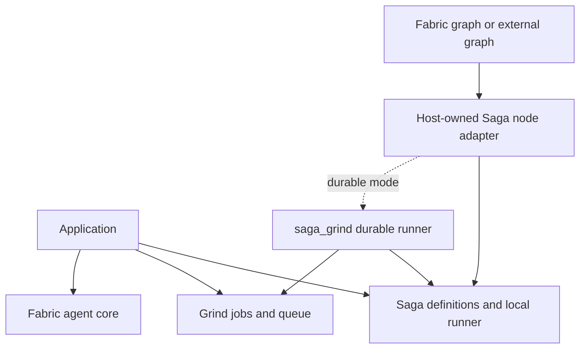
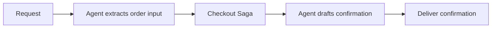

# Composing workflows, jobs, and agents

## Recommendation

- Use Saga as the common typed workflow-authoring layer where the composition is a graph of typed dependencies with explicit failure and compensation rules. Keep the local execution mode and durable execution mode distinct.
- Let Grind run a restricted durable Saga definition through an optional `saga_grind` integration. Grind remains independently usable for ordinary jobs and its lower-level job workflows.
- Let a Saga workflow appear as one typed node in Fabric or an external graph. A host that already implements the required dependency and compensation semantics can instead use Saga directly as its workflow layer.
- These recommendations refine the [creation plan](../ECOSYSTEM-PLAN.md). They are interface hypotheses, not compiled APIs or evidence of implemented durable execution.

## Three compositions with different guarantees

| Composition                                  | What is reused                                                | Recovery boundary                                                                      |
| -------------------------------------------- | ------------------------------------------------------------- | -------------------------------------------------------------------------------------- |
| A Grind job runs a whole local Saga          | Existing local workflow definition and executor               | The job restarts the whole Saga; intermediate values and undo state are not durable    |
| A durable Saga definition runs through Grind | Typed authoring, dependency semantics, and compensation rules | The durable runner records individual operation outcomes and compensation progress     |
| A Saga runs as one graph node                | Typed input/output and the entire nested workflow             | The host observes one node; recovery depends on whether that child is local or durable |

- The first composition is useful for bounded, replay-safe work. It must not be advertised as per-step durable recovery.
- In that composition, record terminal Saga success, business failure, and undo failure as terminal workflow results with a non-retryable job outcome by default. Preserve the failed workflow status explicitly; do not turn a completed compensation sequence into a retryable job error.
- Process or lease loss may still trigger whole-job delivery recovery under the declared replay-safety contract. Whole-run retry after a reported business failure requires a separate explicit policy, and cancellation maps to a terminal cancelled outcome rather than a retryable error.
- The second is the recommended direction for defining typed Grind workflows. It introduces real workflow coordination and journaling work; it is not merely a function-name adapter.
- The third allows reuse without making the outer graph understand Saga internals. Flattening a Saga into host-native nodes is a different integration with different ownership.

## Shared authoring, two execution modes

- Keep the expressive local `Plan` form for closures, arbitrary local transformations, and closure-captured undo values.
- Introduce a distinct opaque durable definition, conceptually `Definition(input, output, error, undo_error)`, built from stable operation identities, versions, and codecs. The exact name and type parameters remain subject to the compiler experiment.
- A durable definition should run through a local interpreter for development and through `saga_grind` for persistence. An arbitrary local plan does not automatically qualify as a durable definition.
- Share the meaning of operations such as dependency composition, parallel combination, retry after an observed failure, and compensation. Reuse pure readiness and compensation-transition logic where both runners satisfy the same laws; do not require a universal executor interface before proving the representations.
- A registered operation associates typed input/output/error contracts with its implementation. Durable compensation also needs the input/output data it consumes, a stable operation version, and a declared error/retry contract.
- Initially, durable transformations and branch selectors should be named and versioned. Journal selected branch identities; do not assume an arbitrary closure passed to `map` or `and_then` is pure or deterministic.
- Executable closures may exist in deployed, versioned workflow factories. The restriction is on persisting them as run state: restore loads the matching factory, checks stable node identities and definition compatibility, and decodes recorded values.
- A later deterministic replay model could permit more expressive factory code. That requires a separate replay/versioning contract because Gleam's type checker does not prove absence of side effects or deterministic behavior.

## Dependency direction

- Saga must not depend on Grind or Fabric. The durable integration depends on both Saga and Grind, and the host owns the graph-node adapter.
- Keep Fabric's independently useful agent core free of graph and queue dependencies. Put integrations requiring those dependencies in examples or optional distribution units; naming a module optional does not make its package dependencies optional.
- Do not introduce a universal task/context package yet. Start with ordinary typed functions, codecs, and explicit mappings between each component's concrete outcomes; extract shared contract code only after two consumer implementations demonstrate identical semantics.

## Durable runner ownership

| Owner                       | Responsibility                                                                                                      |
| --------------------------- | ------------------------------------------------------------------------------------------------------------------- |
| Saga definition             | Dependency meaning, activity retry policy, compensation policy, and typed operation connections                     |
| `saga_grind` durable runner | Workflow progress, operation completion, compensation journal, branch selection, revisions, and readiness decisions |
| Grind                       | Job admission, capacity, claims, leases, worker execution, and delivery recovery                                    |
| Fabric or another host      | Its own graph state, approval policy, child run references, and typed adaptation of child results                   |
| Sinal                       | Observations about transitions already owned elsewhere                                                              |

- Persist definition identity/version, run input, operation identities, codec versions, outcomes, compensation progress, cancellation intent, and store revision. Preserve old executable operation versions or provide an explicit migration policy.
- Coordinate completion recording and admission of newly ready jobs in one transaction when possible. Across stores, use a transactional outbox and idempotent admission so a crash cannot permanently lose a dependent operation.
- Keep queue delivery recovery separate from retry after an observed business failure. They have different counters and ambiguity rules even if both ultimately schedule work through Grind.
- Do not run the local Saga scheduler inside every durable operation or retry the entire outer workflow automatically. The durable runner is the sole owner of graph progress and compensation progress in this mode.
- Submission returns a typed run handle or identifier, not the final output. A host waits on committed state or reliable delivery, then obtains the terminal typed result; telemetry is never the control channel for resume.
- A lost worker after an external effect but before recording completion remains ambiguous unless downstream idempotency, fencing, or an atomic transaction resolves it. Compensation must not guess whether the forward effect occurred.
- Preserve Grind's lower-level dependency policies for compatibility with job workflows. A raw job DAG need not return a typed final value or support Saga compensation; typed Saga authoring is an additional composition layer.

## Saga as an agent-graph node

- The checkout node accepts a typed order input and returns a receipt or a structured failure. Internally it creates an order, reserves inventory, checks fraud, and charges payment; other nodes need not know that structure.
- Nesting is opaque by default. The inner Saga owns its internal scheduling and compensation, while the host owns only the nested node's lifecycle.
- If the inner Saga fails, it applies its declared compensation policy and reports both the original failure and any undo failures. The host must not independently retry or compensate the same inner steps.
- If checkout succeeds and confirmation delivery later fails, a plain graph leaves checkout's effects in place. The application may retry delivery or reconcile the failure.
- A compensation-capable outer workflow may instead request a compensation-enabled child result. That result carries an opaque receipt which permits one logical compensation request to the child; it does not guarantee that remote compensation effects execute exactly once.
- A local receipt can contain closures and is lost with its process. A durable receipt must refer to the child's persisted run and journal, with revision and deduplication checks; the outer workflow records one compensation action for the child.
- Opt-in introspection may expose node labels, realized dependency structure, progress, and nested spans. It must not give the outer scheduler authority to reschedule or resume individual child steps.
- Flatten only through a deliberate translation that transfers scheduling, retries, and compensation ownership to the host. An opaque nested node and a flattened graph are not interchangeable execution modes.

## Agent as a Saga step

- A bounded read-only agent call can be a query-like step. A side-effecting agent call needs explicit business compensation or effect receipts; deleting its transcript does not undo executed tools.
- A call that may await human approval is not an ordinary completed value or a failed step. The integration must expose suspension and preserve an owned resume token instead of triggering Saga compensation.
- For the first durable composition, place approval in the outer Fabric flow and start the side-effecting Saga after approval. Add a suspending agent inside a Saga only after defining one continuation owner and proving the resume contract.
- Map errors at the adapter boundary while preserving the distinction between business failure, undo failure, cancellation, suspension, and ambiguous effects. Do not collapse them into an ecosystem-wide string error.

## Resource and cancellation rules

- Child execution inherits the caller's cancellation and cannot extend its deadline. Record cancellation intent, stop new admissions, and settle running effects according to the workflow's declared policy.
- Suspending or waiting on queued child work must release the worker capacity that the child needs. An outer job waiting for a child in the same single-slot queue would otherwise deadlock.
- Set one explicit concurrency budget for nested work, or partition the parent's budget among children. Independent hidden limits can oversubscribe the system even when every library obeys its own local limit.
- Outer retries of a completed or partly executed child are disabled by default. Enabling them requires a declared idempotency or reconciliation contract.

## Reuse outside the workflow stack

- One application function and its codecs can be registered as a Relay tool, a Fabric tool, or a Grind worker. Each adapter supplies its own authorization, retry, error, and lifetime policy; no application must import Fabric merely to expose a function.
- Blueprint supplies shared data contracts without owning execution. Sinal supplies instrumentation interoperable with existing BEAM handlers without owning progress or delivery.
- The standalone LLM client remains usable by a web endpoint, a Saga step, or an agent. Warden remains usable by an ordinary web application or an optional Relay authentication adapter.
- Share a graph utility only after two real consumers need identical structural operations. Similar-looking graphs do not establish that agent control flow and compensating data dependencies have the same semantics.

## Next composition experiments

- Author one checkout durable definition and run its typed consumer through a local runner interface and a Grind-backed runner interface. Wrong operation output connections must fail for the intended type error; unsupported local closures must not be accepted silently by durable submission.
- Place that checkout inside a graph as one node, then inside a compensating outer workflow. Make the completion receipt and the outer-failure policy explicit in the respective signatures.
- Submit a durable child and model the host as waiting on its run reference. The signatures must distinguish submission, suspension, completion, failure, cancellation, and ambiguous effects.
- Register the same typed application operation as an MCP tool, an agent tool, and a job. Verify each consumer can import only the integrations it uses.
- Prove minimal representations constructively; unfinished scheduler and I/O bodies do not establish durability. Later behavior tests must cover restart, stale revisions, nested compensation failure, delivery races, capacity-one deadlock, and mismatched definition versions.

## Evidence boundary

- This exploration compares the existing [Saga](../saga-design.md), [Grind](../grind-design.md), and [Fabric](../fabric-design.md) drafts with the earlier [execution research](workflow-boundaries.md). It introduces architectural proposals and has not compiled or executed the proposed integrations.
- The main change is shared workflow authoring and semantics with explicit execution modes. The added durable runner must earn its guarantees through its own journal, transactional coordination, and fault tests.
