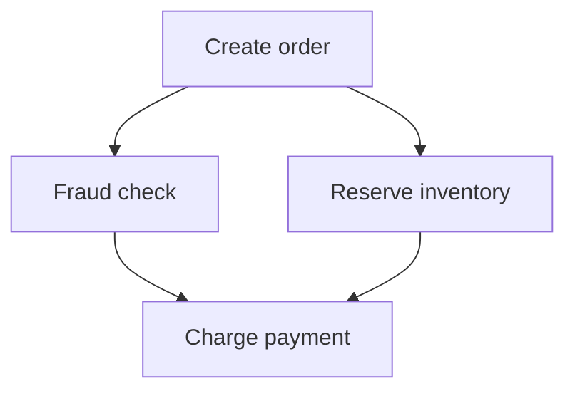

Yes—very feasible, but it should not be a line-for-line port of Elixir Reactor.

Elixir Reactor is intentionally dynamic: step arguments are maps of `any`,
results are referenced by names, and steps can be added while execution is
underway. It turns those references into a DAG and executes independent steps
concurrently. [Reactor’s documentation](https://reactor.hexdocs.pm/readme.html)
describes it as a “dynamic, concurrent, dependency resolving saga orchestrator,”
and its step interface confirms the extensive use of `any`.
[Reactor.Step](https://reactor.hexdocs.pm/Reactor.Step.html)

A strongly typed Gleam equivalent should represent dependencies through typed
values and combinators—not names.

## The core abstraction

I would model it around three opaque types:

```gleam
pub opaque type Reactor(input, output, error, undo_error)

pub opaque type Plan(value, error, undo_error)

pub opaque type Runtime
```

A `Plan(value, error, undo_error)` means:

> An executable graph fragment that will eventually produce `value`, may fail
> with `error`, and may fail during rollback with `undo_error`.

The essential API could look approximately like this:

```gleam
pub fn new(
  build: fn(Plan(input, error, undo_error)) ->
    Plan(output, error, undo_error),
) -> Reactor(input, output, error, undo_error)

pub fn effect(
  label: String,
  dependency: Plan(input, error, undo_error),
  run: fn(input) -> Result(output, error),
  undo: fn(output, input) -> Result(Nil, undo_error),
) -> Plan(output, error, undo_error)

pub fn query(
  label: String,
  dependency: Plan(input, error, undo_error),
  run: fn(input) -> Result(output, error),
) -> Plan(output, error, undo_error)

pub fn map(
  plan: Plan(a, error, undo_error),
  transform: fn(a) -> b,
) -> Plan(b, error, undo_error)

pub fn zip(
  left: Plan(a, error, undo_error),
  right: Plan(b, error, undo_error),
) -> Plan(#(a, b), error, undo_error)

pub fn and_then(
  plan: Plan(a, error, undo_error),
  next: fn(a) -> Plan(b, error, undo_error),
) -> Plan(b, error, undo_error)

pub fn run(
  reactor: Reactor(input, output, error, undo_error),
  input: input,
) -> Result(
  output,
  Failure(error, undo_error),
)
```

`Plan` should be opaque so that users can only construct valid graphs using the
library’s combinators. Gleam explicitly supports opaque types and smart
constructors for enforcing this kind of invariant.
[Gleam opaque types](https://tour.gleam.run/advanced-features/opaque-types/)

## What a workflow would look like

Suppose we have:

```gleam
pub type CheckoutInput {
  CheckoutInput(
    customer_id: CustomerId,
    items: List(Item),
    payment_method: PaymentMethod,
  )
}

pub type CheckoutError {
  OrderCreationFailed(OrderError)
  InventoryReservationFailed(InventoryError)
  FraudCheckFailed(FraudError)
  PaymentFailed(PaymentError)
}

pub type UndoError {
  OrderCancellationFailed(OrderError)
  InventoryReleaseFailed(InventoryError)
  RefundFailed(PaymentError)
}
```

The reactor definition might look like this:

```gleam
pub fn checkout()
  -> saga.Reactor(
    CheckoutInput,
    Receipt,
    CheckoutError,
    UndoError,
  ) {
  saga.new(fn(input) {
    let order =
      input
      |> saga.effect(
        label: "create order",
        run: create_order,
        undo: cancel_order,
      )

    let reservation =
      order
      |> saga.effect(
        label: "reserve inventory",
        run: reserve_inventory,
        undo: release_inventory,
      )

    let fraud_check =
      order
      |> saga.query(
        label: "check fraud",
        run: check_fraud,
      )

    let payment_input =
      saga.zip(reservation, fraud_check)
      |> saga.map(fn(results) {
        let #(reservation, fraud_result) = results

        ChargePayment(
          reservation: reservation,
          fraud_result: fraud_result,
        )
      })

    payment_input
    |> saga.effect(
      label: "charge payment",
      run: charge_payment,
      undo: refund_payment,
    )
    |> saga.map(receipt_from_payment)
  })
}
```

The strings here are only diagnostic labels. They do not identify dependencies
or transport values.

The actual dependency is:

```gleam
Plan(Reservation, CheckoutError, UndoError)
```

If `charge_payment` accidentally expects a `Customer` instead of
`ChargePayment`, the program does not compile.

## Typed DAG construction

`zip` communicates both dependency and concurrency:

```gleam
let fraud_and_inventory =
  saga.zip(fraud_check, reservation)
```

Semantically:



Because the two branches consume the same upstream `order` but do not depend on
each other, the runtime can execute them concurrently.

This gives you Reactor-like dependency resolution without:

```elixir
argument :order, result(:create_order)
```

There is no string/atom lookup, no argument map, and no runtime cast.

## Shared dependencies without `Dynamic`

The important implementation trick is that each `Plan` represents a memoized
node.

If the same plan is used twice:

```gleam
let order = create_order(input)

let inventory = reserve_inventory(order)
let fraud = check_fraud(order)
```

`order` must execute once, not once per consumer.

Internally, each plan node can own:

- Its typed output state.
- Its dependency closures.
- A typed receiver for its result.
- A uniform, untyped-in-the-benign-sense lifecycle interface for the scheduler:
  start, cancel, status and metadata.

The scheduler never needs a central structure like:

```gleam
Dict(NodeId, Dynamic)
```

Instead, the node closure or node actor owns its concrete result type. Consumers
receive that result through a typed interface.

The central scheduler only sees events such as:

```gleam
pub type NodeEvent {
  Started(NodeId)
  Completed(NodeId)
  Failed(NodeId)
  Retrying(NodeId, attempt: Int)
  Undone(NodeId)
}
```

It does not manipulate the actual `Customer`, `Order`, or `Payment` values.

## Heterogeneous undo without `Dynamic`

A saga journal normally contains successful results of different types:

- `Order`
- `Reservation`
- `Payment`
- etc.

A naïve implementation would need `List(Dynamic)`. But closures remove that
requirement:

```gleam
type UndoAction(undo_error) {
  UndoAction(fn() -> Result(Nil, undo_error))
}

type Execution(value, undo_error) {
  Execution(
    value: value,
    undo_actions: List(UndoAction(undo_error)),
  )
}
```

After an effect succeeds, the runtime creates a closure:

```gleam
let undo_action =
  UndoAction(fn() {
    undo(output, input)
  })
```

The closure privately captures the correctly typed `input` and `output`. The
journal only stores homogeneous functions:

```gleam
List(UndoAction(UndoError))
```

There are:

- No casts.
- No `Dynamic`.
- No encoded values.
- No central heterogeneous value map.

This is probably the most important architectural technique for a typed Gleam
Reactor.

## Compensation and retry

Reactor distinguishes:

- Compensation of the currently failing step.
- Undoing earlier successful steps.
- Retrying.
- Continuing with a replacement value.

That can also be made typed:

```gleam
pub type Compensation(value, error) {
  Retry
  RetryAfter(Int)
  Continue(value)
  Fail(error)
}

pub fn recover(
  plan: Plan(value, error, undo_error),
  handler: fn(error, Int) -> Compensation(value, error),
) -> Plan(value, error, undo_error)
```

Because `Continue` contains `value`, the replacement must have exactly the
step’s output type.

```gleam
fn recover_exchange_rate(
  error: RateError,
  attempt: Int,
) -> saga.Compensation(ExchangeRate, RateError) {
  case error, attempt {
    NetworkError, attempt if attempt < 3 ->
      saga.RetryAfter(500 * attempt)

    _, _ ->
      saga.Continue(cached_exchange_rate())
  }
}
```

It is impossible to accidentally compensate an `ExchangeRate` step with an
`Order`.

## Dynamic branching is still possible

Strong typing does not mean the entire graph must be statically fixed.

`and_then` can choose the next typed plan based on a result:

```gleam
order
|> saga.and_then(fn(order) {
  case order.total >. 10_000.0 {
    True -> manual_review(order)
    False -> automatic_approval(order)
  }
})
```

Both branches must ultimately produce the same output and error types:

```gleam
Plan(Approval, CheckoutError, UndoError)
```

Dynamic homogeneous fan-out is also straightforward:

```gleam
pub fn traverse_parallel(
  values: List(a),
  run: fn(a) -> Plan(b, error, undo_error),
) -> Plan(List(b), error, undo_error)
```

So you can create one step per order item at runtime without losing type safety.

## Where exact Reactor parity becomes impossible

The typed design cannot support every form of Reactor dynamism without some form
of type erasure.

| Capability                                           | Strongly typed Gleam             |
| ---------------------------------------------------- | -------------------------------- |
| Typed step input/output                              | Excellent                        |
| Compile-time dependency validation                   | Excellent                        |
| Concurrent independent branches                      | Yes                              |
| Saga undo/compensation                               | Yes                              |
| Retry, timeout and backoff                           | Yes                              |
| Typed conditional branches                           | Yes                              |
| Runtime homogeneous fan-out                          | Yes                              |
| Nested/composed reactors                             | Yes                              |
| Add arbitrary known typed steps at runtime           | Yes, through `and_then`          |
| Load arbitrary step types from configuration         | No                               |
| Reference arbitrary results by names                 | Intentionally no                 |
| Serialize arbitrary workflow closures                | No                               |
| Store heterogeneous results centrally                | Requires `Dynamic` or unsafe FFI |
| Return arbitrary heterogeneous new steps from a step | Not generically                  |

The main incompatible feature is this Reactor result:

```elixir
{:ok, value, dynamically_created_steps}
```

If those new steps can have arbitrary output types, Gleam needs an existential
type, GADT-like encoding, `Dynamic`, or a closed application-specific ADT.

The typed replacement is:

```gleam
and_then(current_plan, fn(value) {
  build_more_typed_plans(value)
})
```

That offers dynamic execution, but only through code whose types are known at
compile time.

## Error types must be deliberately unified

Different steps naturally have different error types. Before they can
participate in one reactor, map them into a workflow error ADT:

```gleam
create_order_plan
|> saga.map_error(OrderCreationFailed)
```

Likewise:

```gleam
reserve_plan
|> saga.map_error(InventoryReservationFailed)
```

This is some additional ceremony, but it produces a valuable property: callers
know every business failure the complete workflow can return.

Using `Dynamic` would explicitly give up that knowledge; Gleam’s documentation
defines `Dynamic` as data whose type is not yet known and which must later be
decoded. [Gleam Dynamic](https://hexdocs.pm/gleam_stdlib/gleam/dynamic.html)

## The real trade-off

The Gleam library would be less like a configurable workflow engine and more
like a typed effect-graph library.

That distinction matters:

- Elixir Reactor starts with a runtime graph and resolves runtime references.
- Typed Gleam starts with composable typed computations and derives execution
  dependencies from their composition.

You gain:

- Compile-time wiring validation.
- No missing result names.
- No incorrect argument keys.
- No runtime downcasts.
- Typed branches and compensation.
- Cycles largely unrepresentable by ordinary construction.

You give up:

- Completely open runtime graphs.
- Easy workflow serialization.
- Configuration-defined heterogeneous steps.
- Some generic introspection and graph rewriting.

## Feasibility verdict

It is absolutely feasible on Gleam’s Erlang target, including concurrency,
retries, process isolation and saga rollback.

The best implementation would use:

1. `Plan(value, error, undo_error)` as an opaque typed graph fragment.
2. Typed combinators such as `map`, `zip`, `and_then`, and `traverse_parallel`.
3. Memoized nodes so shared dependencies execute once.
4. Node-owned typed results instead of a central heterogeneous result map.
5. Closure-packed undo actions for a homogeneous rollback journal.
6. Separate metadata for tracing and visualization.
7. A workflow-specific error ADT.
8. Erlang processes/tasks underneath for concurrent execution.

I would not attempt to port Reactor’s DSL or internal structs. I would preserve
its execution semantics—dependency scheduling, concurrency, retry, compensation
and undo—while replacing named runtime wiring with a typed applicative/monadic
graph API. That would feel natural in Gleam and would be meaningfully safer than
the original dynamic design.

Yes. In fact, that is probably the cleanest design for UI-created graphs.

The key is a two-level type system:

1. Gleam types statically type the predefined node implementations.
2. JSON Schemas type the values and connections created at runtime.

A runtime schema cannot become a new native Gleam type—the compiler has already
run—but it can produce an opaque, schema-validated runtime value with equivalent
safety inside the graph engine.

Assuming “no recursion” means no cyclic `$ref`: arrays and nested objects are
still finite schema trees. If you mean strictly flat JSON objects, the same
model becomes even simpler.

## Runtime type model

Use a restricted, explicit subset of JSON Schema:

```gleam
pub type Schema {
  NullSchema
  BoolSchema
  NumberSchema(NumberConstraints)
  StringSchema(StringConstraints)
  ArraySchema(items: Schema, constraints: ArrayConstraints)
  ObjectSchema(
    fields: List(Field),
    additional_properties: Bool,
  )
  OneOfSchema(variants: List(Schema))
}

pub type Field {
  Field(
    name: String,
    schema: Schema,
    required: Bool,
  )
}
```

This is structurally recursive because JSON itself is nested, but every schema
value is a finite tree. There are no schema references or cycles.

The runtime JSON representation can also be an ordinary closed ADT:

```gleam
pub type JsonValue {
  Null
  BoolValue(Bool)
  NumberValue(Float)
  StringValue(String)
  ArrayValue(List(JsonValue))
  ObjectValue(Dict(String, JsonValue))
}
```

No `Dynamic` is necessary.

## Schema-validated values

Never pass raw `JsonValue` to graph nodes. Wrap successfully validated values in
an opaque type:

```gleam
pub opaque type TypedValue {
  TypedValue(
    schema: Schema,
    value: JsonValue,
  )
}

pub fn validate_value(
  schema: Schema,
  value: JsonValue,
) -> Result(TypedValue, List(ValidationError))
```

Because the constructor is private, a `TypedValue` can only exist if it conforms
to its schema.

Useful accessors remain checked:

```gleam
pub fn schema(value: TypedValue) -> Schema

pub fn raw(value: TypedValue) -> JsonValue

pub fn get_field(
  value: TypedValue,
  field: String,
) -> Result(TypedValue, AccessError)
```

`get_field` derives the returned schema from the parent object schema. It does
not merely retrieve an arbitrary JSON field.

## Parametric node definitions

Predefined node kinds can have type parameters:

```text
Identity<T>       : T → T
Delay<T>          : T → T
Choose<T>         : Bool × T × T → T
Collect<T>        : T... → Array<T>
Constant<T>       : () → T
Validate<T>       : Json → T
Map<A, B>         : Array<A> × Graph<A, B> → Array<B>
LLM<Input, Output>: Input → Output
```

Represent their signatures with a small type-expression language:

```gleam
pub opaque type TypeVariable {
  TypeVariable(Int)
}

pub type TypeExpression {
  Concrete(Schema)
  Variable(TypeVariable)
  ArrayOf(TypeExpression)
  OptionalOf(TypeExpression)
  ObjectOf(List(TypeField))
}
```

A node definition could be:

```gleam
pub type NodeDefinition {
  NodeDefinition(
    kind: NodeKind,
    version: Int,
    inputs: List(PortDefinition),
    outputs: List(PortDefinition),
    configuration_schema: Schema,
  )
}

pub type PortDefinition {
  PortDefinition(
    port: PortKind,
    value_type: TypeExpression,
  )
}
```

For `Identity<T>`:

```gleam
NodeDefinition(
  kind: IdentityNode,
  version: 1,
  inputs: [
    PortDefinition(InputPort, Variable(TypeVariable(0))),
  ],
  outputs: [
    PortDefinition(OutputPort, Variable(TypeVariable(0))),
  ],
  configuration_schema: empty_object_schema(),
)
```

## Instantiation and unification

When a user connects an `Order` output to `Identity<T>`:

```text
CreateOrder.output: Order
          ↓
Identity<T>.input: T
```

The graph validator unifies:

```text
T = OrderSchema
```

The instantiated node becomes:

```text
Identity<Order> : Order → Order
```

Its output schema is now automatically `OrderSchema`.

If another consumer expects `CustomerSchema`, the connection is rejected before
execution.

```gleam
pub fn instantiate_node(
  definition: NodeDefinition,
  incoming: List(ConnectedPort),
  configuration: TypedValue,
) -> Result(InstantiatedNode, List(TypeError))
```

Internally:

```gleam
pub type TypeBindings {
  TypeBindings(Dict(TypeVariable, Schema))
}
```

The unifier handles cases such as:

```text
T                    = Order
Array<T>             = Array<Order>
Optional<T>          = Optional<Order>
Object { value: T }  = Object { value: Order }
```

Because schemas cannot be cyclic, unification and assignability checks are
bounded by the finite schema trees.

## Runtime node interface

Once instantiated, every node has concrete input and output schemas:

```gleam
pub opaque type InstantiatedNode {
  InstantiatedNode(
    id: NodeId,
    kind: NodeKind,
    input_ports: List(InstantiatedPort),
    output_ports: List(InstantiatedPort),
    run: fn(NodeInputs, RuntimeContext) ->
      Result(NodeOutputs, NodeError),
  )
}
```

The execution interface can be homogeneous:

```gleam
pub type NodeInputs {
  NodeInputs(Dict(PortId, TypedValue))
}

pub type NodeOutputs {
  NodeOutputs(Dict(PortId, TypedValue))
}
```

Although this uses dictionaries, it is not stringly typed:

- `PortId` is opaque.
- Every port has a validated schema.
- Values are opaque `TypedValue`s.
- The graph was type-checked before execution.
- Node outputs are validated against the declared output schemas.

A node cannot successfully emit an invalid value:

```gleam
pub fn output(
  port: InstantiatedPort,
  value: JsonValue,
) -> Result(TypedValue, NodeError) {
  validate_value(port.schema, value)
  |> result.map_error(InvalidNodeOutput(port.id, _))
}
```

## Predefined generic implementations

Many parametric nodes do not need to understand the concrete type.

### Identity

```gleam
fn run_identity(
  node: InstantiatedNode,
  inputs: NodeInputs,
) -> Result(NodeOutputs, NodeError) {
  use value <- inputs.get(node.input_port)

  // Input and output schemas were unified during instantiation.
  Ok(outputs.single(node.output_port, value))
}
```

### Choose

```gleam
fn run_choose(
  node: InstantiatedNode,
  inputs: NodeInputs,
) -> Result(NodeOutputs, NodeError) {
  use condition <- inputs.get_bool(node.condition_port)
  use when_true <- inputs.get(node.true_port)
  use when_false <- inputs.get(node.false_port)

  let selected = case condition {
    True -> when_true
    False -> when_false
  }

  Ok(outputs.single(node.output_port, selected))
}
```

The node has signature:

```text
Choose<T>: Bool × T × T → T
```

Validation ensures both branches have compatible schemas.

### Constant

The user configures both a schema and a value:

```json
{
  "schema": {
    "type": "object",
    "properties": {
      "currency": { "type": "string" },
      "amount": { "type": "number" }
    },
    "required": ["currency", "amount"],
    "additionalProperties": false
  },
  "value": {
    "currency": "BRL",
    "amount": 100
  }
}
```

At graph publication time:

1. Parse the schema into `Schema`.
2. Validate the configured value.
3. Bind `T` to that schema.
4. Instantiate `Constant<T>: () → T`.
5. Store the normalized schema and value.

### LLM structured output

An LLM node could be parameterized by arbitrary finite schemas:

```text
LLM<Input, Output>: Input → Output
```

Its configuration supplies:

- Input schema.
- Output schema.
- Prompt template.
- Model configuration.

The model response is not trusted. It is parsed and validated:

```gleam
fn run_llm(
  node: LlmNode,
  input: TypedValue,
) -> Result(TypedValue, NodeError) {
  use response <- llm.call(
    prompt: render_prompt(node, input),
    output_schema: node.output_schema,
  )

  use json <- parse_json(response)

  validate_value(node.output_schema, json)
  |> result.map_error(InvalidStructuredOutput)
}
```

## Domain-specific nodes remain statically typed

For nodes whose implementation operates on real Gleam domain types, use a codec:

```gleam
pub type Codec(a) {
  Codec(
    schema: Schema,
    decode: fn(JsonValue) -> Result(a, DecodeError),
    encode: fn(a) -> JsonValue,
  )
}
```

Example:

```gleam
pub fn order_codec() -> Codec(Order) {
  Codec(
    schema: order_schema(),
    decode: decode_order,
    encode: encode_order,
  )
}
```

A statically typed implementation:

```gleam
fn reserve_inventory(
  order: Order,
) -> Result(Reservation, InventoryError)
```

is adapted into a runtime node:

```gleam
pub fn typed_node(
  input_codec: Codec(input),
  output_codec: Codec(output),
  run: fn(input) -> Result(output, error),
  map_error: fn(error) -> NodeError,
) -> NodeImplementation
```

Conceptually:

```gleam
fn runtime_run(value: TypedValue) {
  use input <- input_codec.decode(value.raw)
  use output <- run(input)
  let raw_output = output_codec.encode(output)

  validate_value(output_codec.schema, raw_output)
}
```

This creates a useful boundary:

- Inside the implementation: ordinary strongly typed Gleam.
- At graph edges: schema-typed `TypedValue`.
- At the UI/database boundary: untrusted JSON that must be validated.

## Graph publication

I would distinguish drafts from executable graph versions:

```gleam
pub type GraphStatus {
  Draft
  Published
  Retired
}
```

A draft may temporarily contain incomplete or invalid wiring. Publishing
performs the full compilation:

```gleam
pub fn publish(
  draft: DraftGraph,
  registry: NodeRegistry,
) -> Result(PublishedGraph, List(GraphError))
```

Publication should:

1. Decode every configuration.
2. Resolve node definitions and versions.
3. Instantiate type parameters.
4. Unify all connected ports.
5. Derive output schemas.
6. Detect cycles.
7. Validate constants and defaults.
8. Check required inputs.
9. Validate graph-level input/output schemas.
10. Produce an immutable `PublishedGraph`.

Execution only accepts `PublishedGraph`.

## Schema compatibility

Connections do not necessarily require structural equality. Define assignability
deliberately.

For example, an output with additional fields might be acceptable:

```text
Producer:
{
  id: String,
  email: String,
  name: String
}

Consumer:
{
  id: String,
  email: String
}
```

That can be accepted if object values use width subtyping:

```text
producer output <: consumer input
```

Useful rules include:

- Exact primitive types.
- Required consumer fields must exist in producer.
- Producer constraints must be at least as strict where necessary.
- `T` assignable to `Optional<T>`.
- Arrays are covariant only if values are immutable.
- Closed objects reject unexpected fields when values are reconstructed.
- Numeric coercions should be explicit nodes, not implicit conversions.
- `OneOf` compatibility requires careful exhaustive checking.

Keep the first implementation conservative: exact structural equality plus
explicit transformation nodes. Subtyping can be added later.

## Important limitation

A schema-typed runtime value is not the same as a native type parameter:

```gleam
Plan(Order)
```

A schema loaded from the database cannot cause Gleam to manufacture a new static
type such as:

```gleam
Plan(UserCreatedAtRuntime)
```

Instead, it becomes:

```gleam
Plan(TypedValue)
```

with an opaque guarantee that the value conforms to a particular runtime schema.

That is not weak typing. It is essentially a small runtime type system
implemented in Gleam. The graph validator acts as its type checker.

## Recommended model

The resulting architecture would be:

```text
Predefined node implementation
    ├── static Gleam implementation types
    ├── parametric port signature
    ├── configuration schema
    └── version

User-created node instance
    ├── selected predefined node kind
    ├── concrete configuration
    ├── inferred/concrete port schemas
    └── graph connections

Published graph
    ├── all type variables resolved
    ├── all connections checked
    ├── all values validated
    └── executable later without type discovery
```

So yes: finite JSON Schemas plus predefined parametric nodes give you
user-created, serializable, runtime-typed Reactor graphs without `Dynamic`,
without string-encoded dependency types, and without allowing arbitrary untyped
code into the system. This is likely the best balance between a flexible visual
workflow builder and Gleam’s strong static core.
