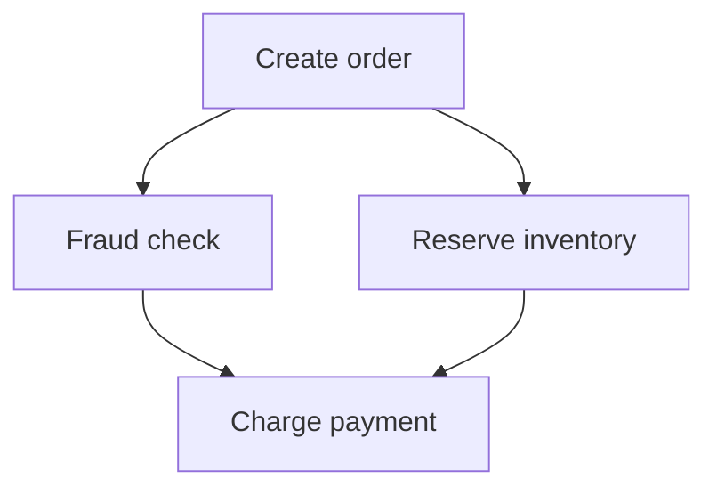

# `saga` — typed workflows and compensation

Saga is a native Gleam workflow engine. It preserves dependency scheduling,
concurrency, retry, compensation, and undo while replacing Reactor’s dynamic
named wiring with typed construction. The initial [public API freeze](PUBLIC-API.md)
limits delivery scope; it does not cancel the capabilities retained below.

Elixir Reactor is intentionally dynamic: step arguments are maps of `any`,
results are referenced by names, and steps can be added while execution is
underway. It turns those references into a DAG and executes independent steps
concurrently. [Reactor’s documentation](https://reactor.hexdocs.pm/readme.html)
describes it as a “dynamic, concurrent, dependency resolving saga orchestrator,”
and its step interface confirms the extensive use of `any`.
[Reactor.Step](https://reactor.hexdocs.pm/Reactor.Step.html)

A strongly typed Gleam equivalent should represent dependencies through typed
values and combinators—not names.

## The core abstraction

The intended authoring model has one canonical opaque workflow definition with
input, output, business-error, and undo-error types. Activities, approvals,
shared dependencies, sequential composition, and closed choices use that same
representation. The laboratory calls it `Definition`; the original `Reactor`
and `Plan` signatures below describe retained composition semantics, not a
second accepted public builder.

[Unified workflows](playground/interface_lab/UNIFIED-WORKFLOWS.md) establishes
construction evidence. A typed activity retains its execution function,
compensation policy, operation identity/version, and four versioned codecs
(input, output, error, undo error). Ordinary workflow persistence uses standard
Gleam JSON encoders/decoders or an
optional schema-independent codec abstraction. Blueprint is needed only for the
runtime-authored JSON Schema surface below. Saga owns the versions and
compatibility of its persisted boundaries; laboratory Blueprint imports are
prototype convenience, not a production dependency requirement. A caller-supplied
structural signature is an assertion, not a computed compatibility proof.

The original conceptual types are:

```gleam
pub opaque type Reactor(input, output, error, undo_error)

pub opaque type Plan(value, error, undo_error)

pub opaque type Runtime
```

A `Plan(value, error, undo_error)` means:

> An executable graph fragment that will eventually produce `value`, may fail
> with `error`, and may fail during rollback with `undo_error`.

The retained combinator semantics are illustrated by these provisional signatures:

```gleam
pub fn new(
  build: fn(Plan(input, error, undo_error)) ->
    Plan(output, error, undo_error),
) -> Reactor(input, output, error, undo_error)

pub fn effect(
  label: String,
  dependency: Plan(input, error, undo_error),
  run: fn(input) -> Result(output, error),
  undo: fn(output, input) -> Result(Nil, undo_error),
) -> Plan(output, error, undo_error)

pub fn query(
  label: String,
  dependency: Plan(input, error, undo_error),
  run: fn(input) -> Result(output, error),
) -> Plan(output, error, undo_error)

pub fn map(
  plan: Plan(a, error, undo_error),
  transform: fn(a) -> b,
) -> Plan(b, error, undo_error)

pub fn zip(
  left: Plan(a, error, undo_error),
  right: Plan(b, error, undo_error),
) -> Plan(#(a, b), error, undo_error)

pub fn and_then(
  plan: Plan(a, error, undo_error),
  next: fn(a) -> Plan(b, error, undo_error),
) -> Plan(b, error, undo_error)

pub fn run(
  reactor: Reactor(input, output, error, undo_error),
  input: input,
) -> Result(
  output,
  Failure(error, undo_error),
)
```

`Plan` should be opaque so that users can only construct valid graphs using the
library’s combinators. Gleam explicitly supports opaque types and smart
constructors for enforcing this kind of invariant.
[Gleam opaque types](https://tour.gleam.run/advanced-features/opaque-types/)

## What a workflow would look like

Suppose we have:

```gleam
pub type CheckoutInput {
  CheckoutInput(
    customer_id: CustomerId,
    items: List(Item),
    payment_method: PaymentMethod,
  )
}

pub type CheckoutError {
  OrderCreationFailed(OrderError)
  InventoryReservationFailed(InventoryError)
  FraudCheckFailed(FraudError)
  PaymentFailed(PaymentError)
}

pub type UndoError {
  OrderCancellationFailed(OrderError)
  InventoryReleaseFailed(InventoryError)
  RefundFailed(PaymentError)
}
```

The reactor definition might look like this:

```gleam
pub fn checkout()
  -> saga.Reactor(
    CheckoutInput,
    Receipt,
    CheckoutError,
    UndoError,
  ) {
  saga.new(fn(input) {
    let order =
      input
      |> saga.effect(
        label: "create order",
        run: create_order,
        undo: cancel_order,
      )

    let reservation =
      order
      |> saga.effect(
        label: "reserve inventory",
        run: reserve_inventory,
        undo: release_inventory,
      )

    let fraud_check =
      order
      |> saga.query(
        label: "check fraud",
        run: check_fraud,
      )

    let payment_input =
      saga.zip(reservation, fraud_check)
      |> saga.map(fn(results) {
        let #(reservation, fraud_result) = results

        ChargePayment(
          reservation: reservation,
          fraud_result: fraud_result,
        )
      })

    payment_input
    |> saga.effect(
      label: "charge payment",
      run: charge_payment,
      undo: refund_payment,
    )
    |> saga.map(receipt_from_payment)
  })
}
```

The strings here are only diagnostic labels. They do not identify dependencies
or transport values.

The actual dependency is:

```gleam
Plan(Reservation, CheckoutError, UndoError)
```

If `charge_payment` accidentally expects a `Customer` instead of
`ChargePayment`, the program does not compile.

## Typed DAG construction

`zip` communicates both dependency and concurrency:

```gleam
let fraud_and_inventory =
  saga.zip(fraud_check, reservation)
```

Semantically:



Because the two branches consume the same upstream `order` but do not depend on
each other, the runtime can execute them concurrently.

This gives you Reactor-like dependency resolution without:

```elixir
argument :order, result(:create_order)
```

There is no string/atom lookup, no argument map, and no runtime cast.

### Fabric graph requirements accepted by Saga

The [Fabric transfer](fabric-design.md#1-dag--typed-workflow-requirements-reassigned-to-saga)
retains pure graph authoring and validation without processes, clocks, I/O, or
OTP startup. Validation must reject cycles, missing producers, duplicate writers
without a declared reducer, and unreachable outputs. The original Kahn-style
check is a reference mechanism; equivalent validation and typed multiple-writer
reduction remain required beyond current shared-graph probes. Reducer
associativity is an application obligation, not a compiler guarantee.

Control-only edges and arbitrary cyclic control graphs remain excluded from
this transferred value-dependency contract. Bounded iteration belongs inside a
node, including a bounded Fabric agent loop. The loop's policy, tools, budgets,
and continuation remain Fabric-owned; Saga owns its activity or child boundary.
A side-effecting agent needs compensation or effect receipts, and an approval
pause must suspend through one continuation owner rather than fail or rerun the
agent. Suspended agents and concrete sub-agent integration remain unresolved
required consumers, not coverage supplied by ordinary function composition.

## Shared dependencies without `Dynamic`

Each typed dependency represents one memoized node per execution. Fresh
construction tokens separate repeated occurrences of a reused definition.
Stable addresses retain sequence occurrence and nested choice scope; tokens do
not enter persisted identities. Reassociating a sequence changes those addresses
and therefore requires compatibility handling for persisted state.

If the same plan is used twice:

```gleam
let order = create_order(input)

let inventory = reserve_inventory(order)
let fraud = check_fraud(order)
```

`order` must execute once, not once per consumer.

Internally, each plan node can own:

- Its typed output state.
- Its dependency closures.
- A typed receiver for its result.
- A uniform, untyped-in-the-benign-sense lifecycle interface for the scheduler:
  start, cancel, status and metadata.

The scheduler must not use a central native-value structure like:

```gleam
Dict(NodeId, Dynamic)
```

Instead, the node closure or node actor owns its concrete result type. Consumers
receive that result through a typed interface.

The central scheduler only sees events such as:

```gleam
pub type NodeEvent {
  Started(NodeId)
  Completed(NodeId)
  Failed(NodeId)
  Retrying(NodeId, attempt: Int)
  Undone(NodeId)
}
```

It does not manipulate the actual `Customer`, `Order`, or `Payment` values.

## Execution ownership and evidence

Saga owns dependency readiness, bounded in-run concurrency, activity retry,
compensation, undo order, and undo-error accumulation. A direct activity belongs
to its enclosing workflow journal. An independent child owns its own execution
and journal; registering a child never silently flattens it into an activity.
Approval is suspension with retained input and an explicit answer boundary,
not a business failure or a blocked worker.

The [local execution experiment](playground/interface_lab/LOCAL-EXECUTION.md)
executes direct activities, shared dependencies, pair adapters, and sequence
adapters serially. It rejects unsupported approvals, children, and choices
before application callbacks. A reducer issues work; a separate interpreter
executes callbacks and returns correlated completions. Foreign or repeated
completions cannot advance the current state, but copyable state does not
prevent replay or repeated external effects.

Sequential connections preserve decode-then-encode adapters when equal native
types have different wire representations. Shared construction, closed-choice
routing, typed ports, duplicate identities, foreign references, and orphan
rejection have separate construction probes. None establishes concurrent
scheduling, process ownership, or durable execution.

## Heterogeneous undo without `Dynamic`

A saga journal normally contains successful results of different types:

- `Order`
- `Reservation`
- `Payment`
- etc.

A naïve implementation would need `List(Dynamic)`. But closures remove that
requirement:

```gleam
type UndoAction(undo_error) {
  UndoAction(fn() -> Result(Nil, undo_error))
}

type Execution(value, undo_error) {
  Execution(
    value: value,
    undo_actions: List(UndoAction(undo_error)),
  )
}
```

After an effect succeeds, the local runtime retains a closure before encoding its output:

```gleam
let undo_action =
  UndoAction(fn() {
    undo(output, input)
  })
```

The closure privately captures the correctly typed `input` and `output`. The
journal only stores homogeneous functions:

```gleam
List(UndoAction(UndoError))
```

The local native undo journal requires:

- No casts.
- No `Dynamic`.
- No encoded values.
- No central heterogeneous value map.

This is probably the most important architectural technique for a typed Gleam
Reactor.

## Compensation and retry

Successful direct activities undo in reverse actual completion order. An undo
failure does not stop remaining compensators. Terminal reports preserve the
original business failure, boundary failure, or cancellation separately from
located undo failures and uncompensated successes. The serial interpreter has
executable evidence for these rules, including output-encoding failure after a
successful effect. Parallel branch settlement remains required runtime work.

Reactor distinguishes:

- Compensation of the currently failing step.
- Undoing earlier successful steps.
- Retrying.
- Continuing with a replacement value.

The original typed recovery sketch is:

```gleam
pub type Compensation(value, error) {
  Retry
  RetryAfter(Int)
  Continue(value)
  Fail(error)
}

pub fn recover(
  plan: Plan(value, error, undo_error),
  handler: fn(error, Int) -> Compensation(value, error),
) -> Plan(value, error, undo_error)
```

Because `Continue` contains `value`, the replacement must have exactly the
step’s output type.

```gleam
fn recover_exchange_rate(
  error: RateError,
  attempt: Int,
) -> saga.Compensation(ExchangeRate, RateError) {
  case error, attempt {
    NetworkError, attempt if attempt < 3 ->
      saga.RetryAfter(500 * attempt)

    _, _ ->
      saga.Continue(cached_exchange_rate())
  }
}
```

It is impossible to accidentally compensate an `ExchangeRate` step with an
`Order`.

The [activity recovery contract](playground/interface_lab/ACTIVITY-RECOVERY.md)
refines that sketch: recovery receives native input, business cause, and the
remaining attempt budget. A positive limit includes the first attempt. Recovery
still runs after exhaustion because the failed activity may need cleanup.

Retry permission and rollback permission are separate. Retry requires an
application-owned idempotency or reconciliation basis and an explicit
cancellation policy. Replacement output carries its own compensator, retained
before encoding. Abort permits prior-effect rollback explicitly; cleanup failure
alone grants no permission. An unresolved outcome retains typed evidence, the
failed activity, and the completed journal without authorizing retry or undo.

Delayed retry yields a relative duration and correlated wake token; the host
owns timers. Retry after exhaustion remains blocked rather than implying
rollback. Reconciliation authority, real elapsed-time enforcement, callback
exceptions, in-flight timeout/cancellation settlement, and parallel attempts
remain requirements. Provider retry, Saga activity retry, and Grind delivery
recovery must not multiply one effect through hidden policies.

## Dynamic branching is still possible

Strong typing does not mean the entire graph must be statically fixed.

`and_then` can choose the next typed plan based on a result:

```gleam
order
|> saga.and_then(fn(order) {
  case order.total >. 10_000.0 {
    True -> manual_review(order)
    False -> automatic_approval(order)
  }
})
```

Both branches must ultimately produce the same output and error types:

```gleam
Plan(Approval, CheckoutError, UndoError)
```

Dynamic homogeneous fan-out is also straightforward:

```gleam
pub fn traverse_parallel(
  values: List(a),
  run: fn(a) -> Plan(b, error, undo_error),
) -> Plan(List(b), error, undo_error)
```

So you can create one step per order item at runtime without losing type safety.

Dynamic value-dependent branching and bounded homogeneous traversal remain
required capabilities beyond the demonstrated closed choice. The production
contract must define ordering, graph-size limits, cancellation, and concurrency
budgets. Arbitrary local closures remain a local authoring requirement; durable
branch selectors and transformations require stable identities and versions,
with selected branches recorded in the journal. The unified definition must
preserve that distinction without dropping the original local expressiveness.

## Durable execution and freeze/thaw

One canonical definition serves local execution and the optional `saga_grind`
durable integration. Eligibility for persistence is explicit: deployed factories
supply executable callbacks, while snapshots contain data and versioned
identities. Arbitrary closure-bearing local computations are not serializable.
The exact admission boundary for unrestricted local transformations remains
unresolved; it must retain local capability rather than silently constrain it
to the initial static facade.

The durable runner owns workflow progress, readiness, selected branches,
activity outcomes, revisions, child links, and compensation journals. Grind owns
job admission, capacity, claims, leases, delivery, and delivery recovery. Grind
also retains its separate dependency-only job workflows without Saga's typed
final result or compensation contract. Saga must not depend on Grind or Fabric;
the optional integration depends on Saga and Grind.

Running an entire local Saga inside one job restarts the whole local workflow
after delivery loss. It is not per-activity durability. Reported Saga success,
business failure, cancellation, and undo failure become terminal workflow
results by default; retrying a completed failed workflow requires explicit
policy. Durable per-activity execution instead commits outcomes and newly ready
job admission together, or uses a transactional outbox with idempotent admission.

The transferred durable scope includes single-node OTP supervision, memory and
PostgreSQL checkpoint backends, typed completion, review tickets, expected
revision commits, and explicit conflict outcomes. It does not assert distributed
coordination merely because Grind supports durable delivery. Historical review
forks remain required: resuming an earlier revision with a different answer
needs explicit ownership and treatment of already performed effects. Ordinary
restore or retry does not prove safe forking; that effect policy remains
unresolved jointly with Fabric's approval/continuation ownership.

Freeze requires checkpoint permission after quiescence. A data snapshot and a
fresh compatible definition are separate restore inputs. Snapshots contain no
executable closures, actors, sockets, or live worker leases; checkpoint
permission does not prove exclusive ownership of a copyable execution value. Restore validates
identities, codec versions, branch selections, completion order, wait state,
and revision before recovering typed results. It preserves waiting, terminal,
stale-signal, cancellation, migration failure, corrupt-state, and ambiguous-effect
outcomes. Approval signals require authentication, revision checks, and command
deduplication. Suspending execution commits its wait and releases worker capacity.

An external effect followed by worker loss before completion recording remains
ambiguous unless downstream idempotency, fencing, or an atomic transaction
settles it. Freeze/thaw cannot resolve that uncertainty. Snapshot codecs,
unfinished-command persistence, journal transactions, migration, timers, process
recovery, and a real durable runner remain backlog; the checkpoint and Grind
modules contain interface evidence and unfinished bodies, not runtime guarantees.

## Independent children and compensation authority

A child contract retains the definition and actual input/output/error/undo-error
codecs. A persistable child link contains routing and compatibility data, not
closures or credentials. Attachment, reattachment, and observation check owner,
run, definition, structural signature, and boundary versions before decoding.
Unavailable owner, missing run, pruned result, incompatible definition, and
corrupt result remain separate outcomes.

Submission is asynchronous. A prepared command retains exact encoded input,
contract metadata, retention, and command identity. Only a checked admission
receipt yields a typed child handle. Unknown or invalid replies preserve the
original owner route and exact request for reconciliation; a failed retry does
not resolve earlier uncertain admission. Cancellation acknowledges recorded
intent separately from child completion, rollback, or reconciliation.

The parent persists its child attachment and stable commands before treating
admission or adoption as committed. Restart reattaches and observes committed
child state; notifications and Sinal events are not control state. A waiting
parent releases capacity needed by the child. Cancellation and deadlines must
propagate through explicit owner policies, and nested concurrency must respect
one shared or partitioned budget.

Child success does not grant compensation authority. The child owner checks
successful completion, journal retention, claimant identity, and exclusive claim
before issuing a receipt. A durable receipt reference is rebound with a fresh
compatible contract and its actual undo-error codec. One claim admits at most
one logical compensation operation; request replay recovers that operation even
after the original admission deadline. Storage must enforce these rules because
Gleam handles are copyable.

Historical child output remains separate from compensation progress and from
result/journal retention. Compensation can be pending, running, successful,
failed with undo errors, or unresolved. Plain outer failure leaves successful
child effects in place unless the parent holds explicit compensation authority.
Local post-success authority remains required but unfinished; a closure receipt
cannot substitute for a durable owner-backed reference.

[Child attachment](playground/interface_lab/CHILD-ATTACHMENT.md),
[admission](playground/interface_lab/CHILD-ADMISSION.md), and
[compensation](playground/interface_lab/CHILD-COMPENSATION.md) exercise scripted
owner records and immutable command replay. They do not prove storage
atomicity, authorization, races, retention enforcement, process recovery, or
exactly-once remote effects. Parent recovery remains separate from child recovery.

## Where exact Reactor parity becomes impossible

The typed design cannot support every form of Reactor dynamism without some form
of type erasure. This table describes intended capabilities, not implemented
runtime coverage.

| Capability                                           | Strongly typed Gleam             |
| ---------------------------------------------------- | -------------------------------- |
| Typed step input/output                              | Excellent                        |
| Compile-time dependency validation                   | Excellent                        |
| Concurrent independent branches                      | Yes                              |
| Saga undo/compensation                               | Yes                              |
| Retry, timeout and backoff                           | Yes                              |
| Typed conditional branches                           | Yes                              |
| Runtime homogeneous fan-out                          | Yes                              |
| Nested/composed reactors                             | Yes                              |
| Add arbitrary known typed steps at runtime           | Yes, through `and_then`          |
| Load arbitrary step types from configuration         | No                               |
| Reference arbitrary results by names                 | Intentionally no                 |
| Serialize arbitrary workflow closures                | No                               |
| Store heterogeneous results centrally                | Requires `Dynamic` or unsafe FFI |
| Return arbitrary heterogeneous new steps from a step | Not generically                  |

The main incompatible feature is this Reactor result:

```elixir
{:ok, value, dynamically_created_steps}
```

If those new steps can have arbitrary output types, Gleam needs an existential
type, GADT-like encoding, `Dynamic`, or a closed application-specific ADT.

The typed replacement is:

```gleam
and_then(current_plan, fn(value) {
  build_more_typed_plans(value)
})
```

That offers dynamic execution, but only through code whose types are known at
compile time.

## Error types must be deliberately unified

Different steps naturally have different error types. Before they can
participate in one reactor, map them into a workflow error ADT:

```gleam
create_order_plan
|> saga.map_error(OrderCreationFailed)
```

Likewise:

```gleam
reserve_plan
|> saga.map_error(InventoryReservationFailed)
```

This is some additional ceremony, but it produces a valuable property: callers
know every business failure the complete workflow can return.

Using `Dynamic` would explicitly give up that knowledge; Gleam’s documentation
defines `Dynamic` as data whose type is not yet known and which must later be
decoded. [Gleam Dynamic](https://hexdocs.pm/gleam_stdlib/gleam/dynamic.html)

## The real trade-off

The Gleam library would be less like a configurable workflow engine and more
like a typed effect-graph library.

That distinction matters:

- Elixir Reactor starts with a runtime graph and resolves runtime references.
- Typed Gleam starts with composable typed computations and derives execution
  dependencies from their composition.

You gain:

- Compile-time wiring validation.
- No missing result names.
- No incorrect argument keys.
- No runtime downcasts.
- Typed branches and compensation.
- Cycles largely unrepresentable by ordinary construction.

You give up:

- Completely open runtime graphs.
- Easy workflow serialization.
- Configuration-defined heterogeneous steps.
- Some generic introspection and graph rewriting.

## Feasibility verdict

The intended Erlang-target implementation includes concurrency, retries,
process isolation, and saga rollback. Their acceptance obligations remain
separate from the serial laboratory evidence.

The best implementation would use:

1. `Plan(value, error, undo_error)` as an opaque typed graph fragment.
2. Typed combinators such as `map`, `zip`, `and_then`, and `traverse_parallel`.
3. Memoized nodes so shared dependencies execute once.
4. Node-owned typed results instead of a central heterogeneous result map.
5. Closure-packed undo actions for a homogeneous rollback journal.
6. Separate metadata for tracing and visualization.
7. A workflow-specific error ADT.
8. Erlang processes/tasks underneath for concurrent execution.

Saga preserves Reactor’s overlapping execution semantics rather than its DSL
or internal structs. Typed dependency construction replaces named runtime
wiring; scheduling, concurrency, retry, compensation, and undo still require
behavioral comparison.

## Runtime-authored graph scope

Runtime-authored graphs remain a distinct retained Saga capability. The initial
static facade does not represent types introduced after compilation. Blueprint
owns finite runtime data contracts, schema validation, and codecs; Saga owns
node registration, graph type checking, publication, and execution. The schema
and codec semantics below remain Saga requirements, but the concrete types and
error signatures in the following snippets are historical pseudocode, superseded
by Blueprint's checked `Value`, runtime contract, and codec APIs. They are not a
second Saga-owned data-contract library. LLM execution composes the standalone
LLM client; Fabric is optional agent policy, not Saga's provider transport.

The key is a two-level type system:

1. Gleam types statically type the predefined node implementations.
2. JSON Schemas type the values and connections created at runtime.

A runtime schema cannot become a new native Gleam type—the compiler has already
run—but it can produce an opaque, schema-validated runtime value with equivalent
safety inside the graph engine.

Assuming “no recursion” means no cyclic `$ref`: arrays and nested objects are
still finite schema trees. If you mean strictly flat JSON objects, the same
model becomes even simpler.

## Runtime type model

Historical pseudocode (schema AST shape; concrete schema types belong to Blueprint):

Use a restricted, explicit subset of JSON Schema:

```gleam
pub type Schema {
  NullSchema
  BoolSchema
  NumberSchema(NumberConstraints)
  StringSchema(StringConstraints)
  ArraySchema(items: Schema, constraints: ArrayConstraints)
  ObjectSchema(
    fields: List(Field),
    additional_properties: Bool,
  )
  OneOfSchema(variants: List(Schema))
}

pub type Field {
  Field(
    name: String,
    schema: Schema,
    required: Bool,
  )
}
```

This is structurally recursive because JSON itself is nested, but every schema
value is a finite tree. There are no schema references or cycles.

Historical pseudocode (JSON representation; use Blueprint's `Value` in the current
design):

```gleam
pub type JsonValue {
  Null
  BoolValue(Bool)
  NumberValue(Number)
  StringValue(String)
  ArrayValue(List(JsonValue))
  ObjectValue(Dict(String, JsonValue))
}
```

No `Dynamic` is necessary. `Number` is Blueprint's canonical exact JSON number;
native `Int` and `Float` require checked projections. The integer-only laboratory
representation has a deferred migration and is not the final numeric contract.

## Schema-validated values

Historical pseudocode (validated wrapper; Blueprint owns the concrete validated
value and associated error types):

```gleam
pub opaque type TypedValue {
  TypedValue(
    schema: Schema,
    value: JsonValue,
  )
}

pub fn validate_value(
  schema: Schema,
  value: JsonValue,
) -> Result(TypedValue, List(ValidationError))
```

Because the constructor is private, a `TypedValue` can only exist if it conforms
to its schema.

Historical pseudocode (accessor signatures; Blueprint owns checked accessors):

```gleam
pub fn schema(value: TypedValue) -> Schema

pub fn raw(value: TypedValue) -> JsonValue

pub fn get_field(
  value: TypedValue,
  field: String,
) -> Result(TypedValue, AccessError)
```

`get_field` derives the returned schema from the parent object schema. It does
not merely retrieve an arbitrary JSON field.

## Parametric node definitions

Predefined node kinds can have type parameters:

```text
Identity<T>       : T → T
Delay<T>          : T → T
Choose<T>         : Bool × T × T → T
Collect<T>        : T... → Array<T>
Constant<T>       : () → T
Validate<T>       : Json → T
Map<A, B>         : Array<A> × Graph<A, B> → Array<B>
LLM<Input, Output>: Input → Output
```

Represent their signatures with a small type-expression language:

Historical pseudocode (the schema leaf in this expression language is a Blueprint runtime contract):

```gleam
pub opaque type TypeVariable {
  TypeVariable(Int)
}

pub type TypeExpression {
  Concrete(Schema)
  Variable(TypeVariable)
  ArrayOf(TypeExpression)
  OptionalOf(TypeExpression)
  ObjectOf(List(TypeField))
}
```

Historical pseudocode (the stored contract references below are owned by Blueprint):

A node definition could be:

```gleam
pub type NodeDefinition {
  NodeDefinition(
    kind: NodeKind,
    version: Int,
    inputs: List(PortDefinition),
    outputs: List(PortDefinition),
    configuration_schema: Schema,
  )
}

pub type PortDefinition {
  PortDefinition(
    port: PortKind,
    value_type: TypeExpression,
  )
}
```

For `Identity<T>`:

Historical pseudocode:

```gleam
NodeDefinition(
  kind: IdentityNode,
  version: 1,
  inputs: [
    PortDefinition(InputPort, Variable(TypeVariable(0))),
  ],
  outputs: [
    PortDefinition(OutputPort, Variable(TypeVariable(0))),
  ],
  configuration_schema: empty_object_schema(),
)
```

## Instantiation and unification

When a user connects an `Order` output to `Identity<T>`:

```text
CreateOrder.output: Order
          ↓
Identity<T>.input: T
```

The graph validator unifies:

```text
T = OrderSchema
```

The instantiated node becomes:

```text
Identity<Order> : Order → Order
```

Its output schema is now automatically `OrderSchema`.

If another consumer expects `CustomerSchema`, the connection is rejected before
execution.

Historical pseudocode (Blueprint runtime contracts replace `TypedValue` here):

```gleam
pub fn instantiate_node(
  definition: NodeDefinition,
  incoming: List(ConnectedPort),
  configuration: TypedValue,
) -> Result(InstantiatedNode, List(TypeError))
```

Historical pseudocode (schema bindings are references to Blueprint contracts):

Internally:

```gleam
pub type TypeBindings {
  TypeBindings(Dict(TypeVariable, Schema))
}
```

The unifier handles cases such as:

```text
T                    = Order
Array<T>             = Array<Order>
Optional<T>          = Optional<Order>
Object { value: T }  = Object { value: Order }
```

Because schemas cannot be cyclic, unification and assignability checks are
bounded by the finite schema trees.

## Runtime node interface

Once instantiated, every node has concrete input and output schemas:

Historical pseudocode (the `TypedValue` and contract representation is superseded by Blueprint):

```gleam
pub opaque type InstantiatedNode {
  InstantiatedNode(
    id: NodeId,
    kind: NodeKind,
    input_ports: List(InstantiatedPort),
    output_ports: List(InstantiatedPort),
    run: fn(NodeInputs, RuntimeContext) ->
      Result(NodeOutputs, NodeError),
  )
}
```

Historical pseudocode (the value wrappers are superseded by Blueprint runtime values):

The execution interface can be homogeneous:

```gleam
pub type NodeInputs {
  NodeInputs(Dict(PortId, TypedValue))
}

pub type NodeOutputs {
  NodeOutputs(Dict(PortId, TypedValue))
}
```

Although this uses dictionaries, it is not stringly typed:

- `PortId` is opaque.
- Every port has a validated schema.
- Values are opaque `TypedValue`s.
- The graph was type-checked before execution.
- Node outputs are validated against the declared output schemas.

A node cannot successfully emit an invalid value:

Historical pseudocode (validation and codec errors use Blueprint's checked APIs):

```gleam
pub fn output(
  port: InstantiatedPort,
  value: JsonValue,
) -> Result(TypedValue, NodeError) {
  validate_value(port.schema, value)
  |> result.map_error(InvalidNodeOutput(port.id, _))
}
```

## Predefined generic implementations

Many parametric nodes do not need to understand the concrete type.

### Identity

Historical pseudocode (uses the superseded Saga-local runtime value wrapper):

```gleam
fn run_identity(
  node: InstantiatedNode,
  inputs: NodeInputs,
) -> Result(NodeOutputs, NodeError) {
  use value <- inputs.get(node.input_port)

  // Input and output schemas were unified during instantiation.
  Ok(outputs.single(node.output_port, value))
}
```

### Choose

Historical pseudocode (uses the superseded Saga-local runtime value wrapper):

```gleam
fn run_choose(
  node: InstantiatedNode,
  inputs: NodeInputs,
) -> Result(NodeOutputs, NodeError) {
  use condition <- inputs.get_bool(node.condition_port)
  use when_true <- inputs.get(node.true_port)
  use when_false <- inputs.get(node.false_port)

  let selected = case condition {
    True -> when_true
    False -> when_false
  }

  Ok(outputs.single(node.output_port, selected))
}
```

The node has signature:

```text
Choose<T>: Bool × T × T → T
```

Validation ensures both branches have compatible schemas.

### Constant

The user configures both a schema and a value:

```json
{
  "schema": {
    "type": "object",
    "properties": {
      "currency": { "type": "string" },
      "amount": { "type": "number" }
    },
    "required": ["currency", "amount"],
    "additionalProperties": false
  },
  "value": {
    "currency": "BRL",
    "amount": 100
  }
}
```

At graph publication time:

1. Parse the schema into `Schema`.
2. Validate the configured value.
3. Bind `T` to that schema.
4. Instantiate `Constant<T>: () → T`.
5. Store the normalized schema and value.

### LLM structured output

An LLM node could be parameterized by arbitrary finite schemas:

```text
LLM<Input, Output>: Input → Output
```

Its configuration supplies:

- Input schema.
- Output schema.
- Prompt template.
- Model configuration.

The model response is not trusted. This earlier adapter used the superseded local
value wrapper; Saga now composes Blueprint's checked runtime contract:

Historical pseudocode:

```gleam
fn run_llm(
  node: LlmNode,
  input: TypedValue,
) -> Result(TypedValue, NodeError) {
  use response <- llm.call(
    prompt: render_prompt(node, input),
    output_schema: node.output_schema,
  )

  use json <- parse_json(response)

  validate_value(node.output_schema, json)
  |> result.map_error(InvalidStructuredOutput)
}
```

## Domain-specific nodes remain statically typed

Historical pseudocode (codec shape; Blueprint's codec encode path is fallible):

```gleam
pub type Codec(a) {
  Codec(
    schema: Schema,
    decode: fn(JsonValue) -> Result(a, DecodeError),
    encode: fn(a) -> JsonValue,
  )
}
```

Historical pseudocode example:

```gleam
pub fn order_codec() -> Codec(Order) {
  Codec(
    schema: order_schema(),
    decode: decode_order,
    encode: encode_order,
  )
}
```

A statically typed implementation:

```gleam
fn reserve_inventory(
  order: Order,
) -> Result(Reservation, InventoryError)
```

The earlier `typed_node` sketch adapted it into a runtime node as follows. This is
historical pseudocode; Saga will integrate through Blueprint's checked contracts
and codecs:

```gleam
pub fn typed_node(
  input_codec: Codec(input),
  output_codec: Codec(output),
  run: fn(input) -> Result(output, error),
  map_error: fn(error) -> NodeError,
) -> NodeImplementation
```

Historical pseudocode (runtime bridge):

Conceptually:

```gleam
fn runtime_run(value: TypedValue) {
  use input <- input_codec.decode(value.raw)
  use output <- run(input)
  let raw_output = output_codec.encode(output)

  validate_value(output_codec.schema, raw_output)
}
```

This creates a useful boundary:

- Inside the implementation: ordinary strongly typed Gleam.
- At graph edges: schema-typed `TypedValue`.
- At the UI/database boundary: untrusted JSON that must be validated.

## Graph publication

I would distinguish drafts from executable graph versions:

```gleam
pub type GraphStatus {
  Draft
  Published
  Retired
}
```

A draft may temporarily contain incomplete or invalid wiring. Publishing
performs the full compilation:

```gleam
pub fn publish(
  draft: DraftGraph,
  registry: NodeRegistry,
) -> Result(PublishedGraph, List(GraphError))
```

Publication should:

1. Decode every configuration.
2. Resolve node definitions and versions.
3. Instantiate type parameters.
4. Unify all connected ports.
5. Derive output schemas.
6. Detect cycles.
7. Validate constants and defaults.
8. Check required inputs.
9. Validate graph-level input/output schemas.
10. Produce an immutable `PublishedGraph`.

Execution only accepts `PublishedGraph`.

## Schema compatibility

Connections do not necessarily require structural equality. Define assignability
deliberately.

For example, an output with additional fields might be acceptable:

```text
Producer:
{
  id: String,
  email: String,
  name: String
}

Consumer:
{
  id: String,
  email: String
}
```

That can be accepted if object values use width subtyping:

```text
producer output <: consumer input
```

Useful rules include:

- Exact primitive types.
- Required consumer fields must exist in producer.
- Producer constraints must be at least as strict where necessary.
- `T` assignable to `Optional<T>`.
- Arrays are covariant only if values are immutable.
- Closed objects reject unexpected fields when values are reconstructed.
- Numeric coercions should be explicit nodes, not implicit conversions.
- `OneOf` compatibility requires careful exhaustive checking.

Keep the first implementation conservative: exact structural equality plus
explicit transformation nodes. Subtyping can be added later.

## Important limitation

A schema-typed runtime value is not the same as a native type parameter:

```gleam
Plan(Order)
```

A schema loaded from the database cannot cause Gleam to manufacture a new static
type such as:

```gleam
Plan(UserCreatedAtRuntime)
```

Instead, it becomes:

```gleam
Plan(TypedValue)
```

with an opaque guarantee that the value conforms to a particular runtime schema.

That is not weak typing. It is essentially a small runtime type system
implemented in Gleam. The graph validator acts as its type checker.

## Recommended model

The resulting architecture would be:

```text
Predefined node implementation
    ├── static Gleam implementation types
    ├── parametric port signature
    ├── configuration schema
    └── version

User-created node instance
    ├── selected predefined node kind
    ├── concrete configuration
    ├── inferred/concrete port schemas
    └── graph connections

Published graph
    ├── all type variables resolved
    ├── all connections checked
    ├── all values validated
    └── executable later without type discovery
```

So yes: finite JSON Schemas plus predefined parametric nodes give you
user-created, serializable, runtime-typed Reactor graphs without `Dynamic`,
without string-encoded dependency types, and without allowing arbitrary untyped
code into the system. This is likely the best balance between a flexible visual
workflow builder and Gleam’s strong static core.

## Oracle and acceptance obligations

Reactor `v1.0.6` is the pinned behavioral oracle for overlapping scheduling,
retry, compensation, undo, and in-memory halt/resume scenarios. Its
[source and tests](https://github.com/ash-project/reactor/tree/v1.0.6) were
inspected in [workflow research](research/workflow-boundaries.md); the upstream
suite was not run locally. Native typed construction deliberately replaces its
dynamic DSL. Durable checkpoints and runtime schema graphs need original
contracts; Reactor halt is not process-loss durability. Exact parity applies
only to explicitly mapped scenarios, never the whole Reactor API.

The retained test strategy requires equivalent public differential scenarios
against that tag plus native compiler-negative, transition, concurrency, and
fault tests. Prove one execution per shared dependency, bounded concurrency,
typed failure mapping, failed-step compensation versus completed-step undo,
reverse completion order, accumulated undo failures, and cancellation with
active siblings. Test timeout/retry timing, branch settlement, resource limits,
and ambiguous effects independently of representation checks.

Durable tests must restart after commit boundaries, reject stale revisions and
incompatible codecs, recover missed wakes, coordinate parent/child admission,
release capacity in a single-slot queue, resolve cancellation/completion races,
enforce exclusive claims and command deduplication, and resume compensation
through retention and pruning. Runtime graphs require hostile-input publication,
cycle/resource limits, registry version, persistence, and execution tests.

Stable read-only introspection must retain labels, scoped identities,
dependencies, realized branches, and progress without exposing executable
closures or control over child internals. Sinal receives package-owned facts
after transitions; terminal local-report descriptors are demonstrated, while
native delivery and durable event ordering remain runtime obligations.

## Capability disposition

This inventory preserves the original design in commit `9194f02`. “Deferred”
means required implementation backlog, not removed product intent. The
[coverage matrix](API-COVERAGE.md#saga) and
[refinement status](playground/interface_lab/REFINEMENT-STATUS.md) record evidence.

| Original capability                                                                      | Disposition and owner                                                           | Required evidence                                                                                         |
| ---------------------------------------------------------------------------------------- | ------------------------------------------------------------------------------- | --------------------------------------------------------------------------------------------------------- |
| Typed input/output, dependency validation, unified business and undo errors              | Retained in Saga canonical definitions and typed ports                          | Compiler negatives, codec-edge and native error probes; runtime boundary failures                         |
| `map`, `zip`, sequential composition, shared memoized dependencies                       | Retained; construction and serial subset demonstrated                           | One execution per dependency, adapters, bounded parallel Reactor scenarios                                |
| Fabric pure graph validation and associative multiple-writer reducers                    | Reassigned to Saga; retained beyond demonstrated composition                    | Cycles, missing producers, undeclared duplicate writers, unreachable outputs; reducer mapping unresolved  |
| Fabric historical review forks and checkpoint backends                                   | Reassigned durable execution to Saga integration; approval policy stays Fabric  | Memory/PostgreSQL revision fixtures, explicit prior-effect policy, restart and fork tests pending         |
| Bounded agent loops as workflow nodes and suspending agents                              | Retained integration; Fabric owns agent execution policy                        | Bounded iteration without graph cycles; one suspension owner, effect receipts, sub-agent consumer pending |
| Concurrent execution, process isolation, cancellation, timeout and backoff               | Retained, runtime work deferred in Saga                                         | OTP supervision, active-sibling cancellation, timers, resource and fault tests                            |
| Failed-step compensation, typed replacement, retry, reverse-order undo and undo failures | Expanded with explicit rollback permission and unresolved effects               | Serial recovery evidence; Reactor differential scenarios and concurrent settlement still required         |
| Value-dependent `and_then` and runtime homogeneous fan-out                               | Retained, deferred beyond closed choice                                         | Bounded traversal, ordering, cancellation, durable branch/version policy                                  |
| Arbitrary local transformations and closure-owned native results/undo                    | Retained; reconciliation with canonical authoring remains unresolved            | Local capability admission, no silent persistence of closures; do not lose expressiveness                 |
| Nested/composed reactors                                                                 | Expanded into direct composition and independent children                       | Typed construction and scripted owners; local authority, races, restart and compensation runtime tests    |
| Diagnostic labels, metadata, tracing and visualization                                   | Retained in Saga; observation transport belongs to Sinal                        | Stable read-only descriptors and runner facts without control-channel use                                 |
| Finite schemas, validated JSON values, codecs, parametric runtime nodes                  | Data contracts reassigned to Blueprint; graph typing retained in Saga, deferred | Schema/codec laws, exact-number boundaries, node instantiation and unification                            |
| Draft/publication/retirement, immutable executable graphs, registry versions             | Retained in Saga runtime-authored surface, deferred                             | Publication's ten validation checks, hostile graphs, persistence and execution                            |
| Exact structural compatibility with explicit transforms                                  | Retained; width subtyping and broader assignability deferred                    | Conservative connection tests; no implicit coercion or unchecked `OneOf` inclusion                        |
| Serialization of runtime-authored graphs                                                 | Retained; expanded with explicit durable definitions and freeze/thaw            | Snapshot codecs, fresh factory compatibility, crash recovery; never closure serialization                 |
| Arbitrary heterogeneous runtime steps and named native-result lookup                     | Original intentional exclusions retained                                        | Native typing negatives; schema-typed registered graphs are a separate surface                            |

The initial facade leaves these obligations open. No unrun Reactor conformance,
production scheduler, durable runner, or schema-graph implementation is claimed.
